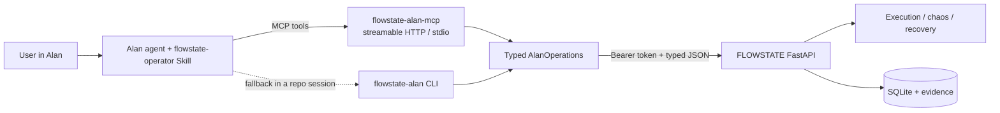

# FLOWSTATE AI — Alan Integration

| Field | Value |
| --- | --- |
| Status | Adapter implemented and locally tested; live workspace invocation unverified |
| Verified | 2026-10-26 |
| Mechanism | Custom MCP connector + team Skill; CLI fallback |
| Related | [ARCHITECTURE.md](ARCHITECTURE.md), [SECURITY.md](SECURITY.md) |

## 1. What was verified

The integration is based on the capabilities Alan actually exposes, not an assumed SDK.

| Capability | Verified fact | Used here |
| --- | --- | --- |
| Custom MCP connector | Alan's **Settings → Plugins → MCP** tab offers **Add custom connector** for your own MCP server; credentials added there are stored encrypted. | Primary typed tool boundary |
| Team Skills | Team Skills are shareable packages with `SKILL.md`, can be created/imported, and are available to sessions. The Alan MCP API exposes `create_skill` / `get_skill` / `list_skills`. | `flowstate-operator` team Skill |
| Workflow tool catalogue | Workflow `tools[]` accepts `builtin`, `integration`, or `mcp`. The available catalogue contains no generic "call this HTTP API" tool. | An MCP connector is required for typed runtime calls |
| Automations | Automations run agent instructions on a schedule/event and can use tools. | Optional scheduling around the same adapter; not required |
| App hosting | Alan docs and this environment do not provide FLOWSTATE application hosting. | Backend runs as its own process; Alan is the caller |

Sources checked: `https://docs.tryalan.ai/docs/skills/plugins-and-mcp`,
`https://docs.tryalan.ai/docs/skills/skills`,
`https://docs.tryalan.ai/docs/automations/create-an-automation`, and the live
`list_workflow_catalogue(kind="tools")` response for this team.

### Exact limitation

There is **no API exposed in this environment to register a custom MCP connector**.
Registration is UI-only in Alan Settings. The server, authentication, tool
schemas and tests are implemented here; a human must add the connector URL and
inbound bearer header once in the Alan UI. The adapter/MCP/CLI tests do not prove
that a live tool invocation succeeded from Alan. That external end-to-end check
remains outstanding; nothing in this repository pretends it happened.

## 2. Architecture



Both transports call the same `AlanOperations` boundary. There is no second
execution path and no model-authored code.

## 3. Operations

Only operations backed by real, tested backend routes are exposed.

| Tool | Backend route(s) | Consequential? |
| --- | --- | --- |
| `list_workflows` | `GET /workflows` | No |
| `inspect_workflow` | `GET /workflows/{id}`, `GET /workflows/{id}/versions/{v}` | No |
| `run_workflow` | `POST /runs` | Yes — confirmation token |
| `get_execution_status` | `GET /runs/{id}`, `/blockers`, `/recoveries`, `/recovery-plan` | No |
| `run_chaos_test` | `GET /scenarios`, `POST /scenarios/{id}/evaluate` | Yes — confirmation token |
| `explain_failure` | persisted run, verdicts, events, blockers and recovery plan | No |
| `list_blockers` | `GET /blockers` | No |
| `inspect_evidence` | `GET /runs/{id}`, `GET /runs/{id}/evidence/{e}` | No |
| `request_recovery` | `GET /runs/{id}/recovery-plan`, `POST /runs/{id}/recover` | Yes — confirmation token |
| `list_regression_tests` | `GET /regression-tests` | No |
| `run_regression_tests` | `POST /regression-tests/{id}/replay` | Yes — confirmation token |

The adapter deliberately does **not** expose workflow editing, deletion, human
decision approval, arbitrary HTTP calls, or a generic shell.

## 4. Confirmation and authority

Consequential calls use a two-step protocol:

1. The tool returns `CONFIRMATION_REQUIRED` plus a deterministic
   `confirmation_token` derived from the action and exact arguments.
2. The Skill shows the summary to the user and asks for explicit approval.
3. Only then does the agent repeat the same call with the token.

The token is not a security capability. Backend authentication, authorization,
actor role, policy, preconditions and evidence freshness remain the authority.
An approval is a re-check, not an override. The adapter cannot approve a
human decision.

Every mutation carries an `Idempotency-Key`. The backend stores the first
response for 24 hours; a retry with the same key and request returns the same
run/report, and the same key with different content is rejected
(`IDEMPOTENCY_CONFLICT`).

## 5. Success semantics

- `is_success` is true only when the persisted run is `SUCCEEDED` and its verdict
  is `VERIFIED`.
- `AWAITING_DECISION`, `AWAITING_RECOVERY`, `BLOCKED`, `UNKNOWN`, `INCONCLUSIVE`,
  `FAILED`, and `TIMED_OUT` are never reported as success.
- `explain_failure` is derived from persisted verdicts, events, blockers,
  recovery attempts and evidence; it never asks a model to invent a cause.
- Every response includes the driver and `execution_kind`, so a
  `simulated-v1` sandbox result is visibly different from a `playwright-v1`
  Chromium result.

## 6. Setup

### 6.1 Backend

```bash
# install adapter extras once
.venv/bin/python -m pip install -e "backend[dev,alan]"

# secrets come from the environment
export FLOWSTATE_API_TOKEN="$(openssl rand -hex 24)"
cd backend && ../.venv/bin/uvicorn flowstate.main:app --port 8000
```

The console can keep running with the same token (`VITE_API_TOKEN`).

### 6.2 MCP server (streamable HTTP)

```bash
export FLOWSTATE_API_URL="http://127.0.0.1:8000/api/v1"
export FLOWSTATE_API_TOKEN="…the same backend token…"
export FLOWSTATE_ALAN_MCP_TOKEN="$(openssl rand -hex 32)"
# optional least privilege:
export FLOWSTATE_ALAN_ALLOWED_WORKFLOWS="invoice-approval,vendor-payout"
export FLOWSTATE_ALAN_READ_ONLY=false

.venv/bin/python -m flowstate.alan.mcp_server \
  --transport streamable-http --host 127.0.0.1 --port 8765
```

Endpoint: `http://127.0.0.1:8765/mcp`. If the host is not loopback, the server
refuses to start without `FLOWSTATE_ALAN_MCP_TOKEN`; put it behind TLS/reverse
proxy for remote use.

### 6.3 Register the connector in Alan (UI-only)

1. Open **Settings → your team → Plugins → MCP**.
2. Choose **Add custom connector**.
3. URL: `https://<your-host>/mcp` (or loopback for a local Alan runtime).
4. Header: `Authorization: Bearer <FLOWSTATE_ALAN_MCP_TOKEN>`.
5. Save and enable it for the team.

This is the one step the repo cannot perform: no connector-registration API is
available in this environment.

### 6.4 Skill

The team Skill `flowstate-operator` is created and enabled in Alan (Skill ID
`e2b15d0c-4f93-4397-8183-8beab5e5a085`, version 1) and its source is in
`integrations/alan/skill/`. It tells the agent which tools to use, when to ask
for inputs, how to present confirmation summaries, and which states are not
success. To use it, type `/flowstate-operator` in the composer or mention a
FLOWSTATE request; Alan can also load it automatically by description.

### 6.5 CLI fallback

For local or cloud sessions where the MCP connector is not registered:

```bash
.venv/bin/flowstate-alan --base-url http://127.0.0.1:8000/api/v1 list-workflows
.venv/bin/flowstate-alan inspect-workflow invoice-approval
.venv/bin/flowstate-alan run-workflow invoice-approval            # exits 2 + token
.venv/bin/flowstate-alan run-workflow invoice-approval --confirm <token>
.venv/bin/flowstate-alan get-execution-status <run-id>
.venv/bin/flowstate-alan explain-failure <run-id>
.venv/bin/flowstate-alan run-chaos-test invoice-approval --scenario "Duplicated gateway response"
.venv/bin/flowstate-alan request-recovery <run-id> --strategy RESUME --confirm <token>
.venv/bin/flowstate-alan run-regression-tests --confirm <token>
```

`FLOWSTATE_API_TOKEN` is read from the environment, never from an argument.

### 6.6 Demo

With the backend running and `FLOWSTATE_API_TOKEN` set:

```bash
make alan-demo
# or
PYTHONPATH=backend .venv/bin/python scripts/alan_demo.py
```

The demo lists/inspects a workflow, requests a run, explains the resulting
`AWAITING_DECISION`, evaluates a `NETWORK_DROP` chaos scenario, explains the
failure, requests verified recovery, and replays a regression test. It never
approves a decision and never claims success without backend verification.

## 7. Failure handling

| Failure | Adapter behavior |
| --- | --- |
| Backend down / DNS | `BACKEND_UNREACHABLE`, no success claim |
| Timeout | `BACKEND_TIMEOUT`; retries only GET or keyed mutations |
| 401/403 | `UNAUTHORIZED` / `INVALID_TOKEN`, no retry |
| 422 | typed validation code and backend field errors |
| Malformed JSON | `MALFORMED_BACKEND_RESPONSE` |
| Ambiguous workflow | `WORKFLOW_AMBIGUOUS` with candidates |
| Missing inputs | `MISSING_INPUTS` with required fields and schema |
| Duplicate key | `IDEMPOTENCY_CONFLICT` for different content; original result for identical content |
| Mutation while read-only | `READ_ONLY_MODE` |
| Workflow outside allowlist | `WORKFLOW_NOT_ALLOWED` |

## 8. Security boundary

- The adapter never accepts a backend token as a tool argument.
- The MCP HTTP ingress requires a separate bearer token.
- Mutations require a confirmation token and backend authorization.
- Human decisions are out of scope; the agent cannot approve.
- Workflow allowlisting and read-only mode are available for least privilege.
- No generated code or arbitrary URL is executed.
- Backend policy still blocks real payment hosts, enforces preconditions and
  records every transition in the hash-linked audit chain.
- The backend's unit of work is function-scoped, so the transaction commits
  before the HTTP response is sent. A tool never receives a run id that is not
  yet readable by the next tool call.

## 9. Remaining limitations

- Connector registration is UI-only; it is not automated here.
- The MCP server is synchronous per tool call; long browser runs block until the
  backend responds. Existing backend timeouts and adapter timeouts apply.
- The adapter uses a configured human operator identity for recovery because the
  backend requires a human actor. The Skill requires explicit user approval; the
  adapter does not approve decisions.
- Alan does not host FLOWSTATE. The backend must be reachable from the Alan
  runtime.
- No Slack/Teams human-approval bridge is implemented; decisions remain in the
  FLOWSTATE Decision Inbox.
