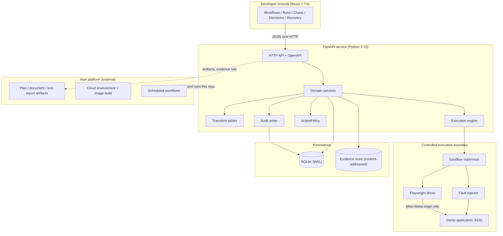
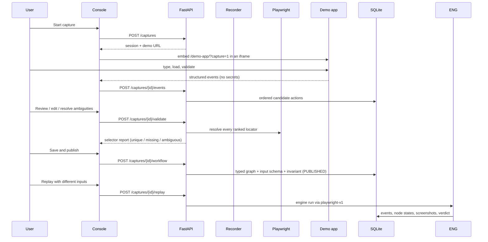
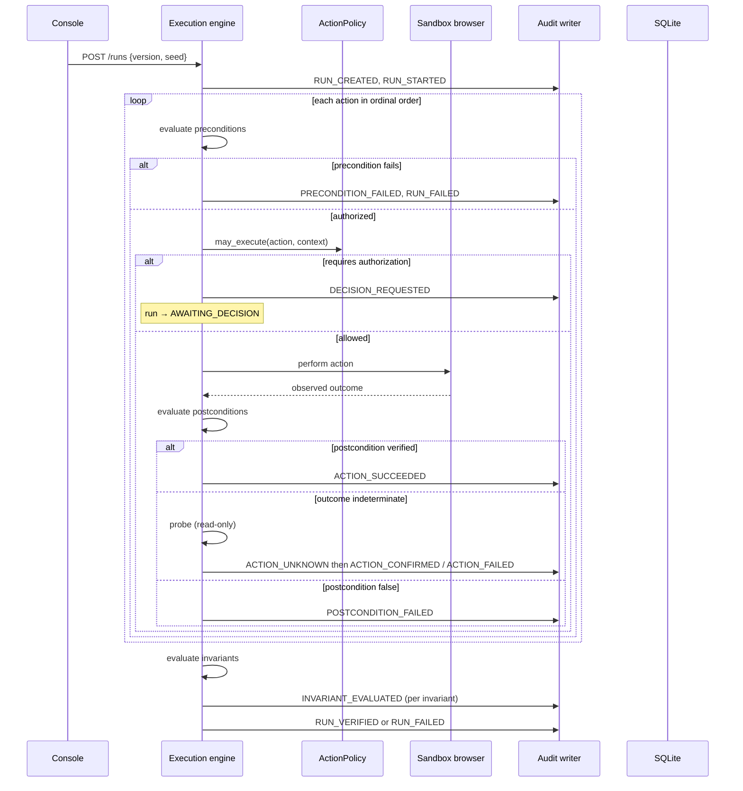
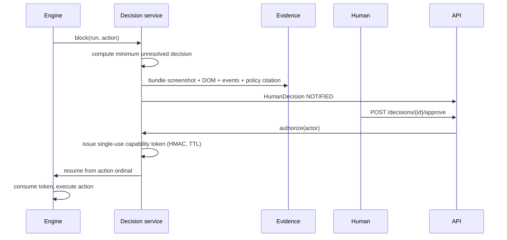
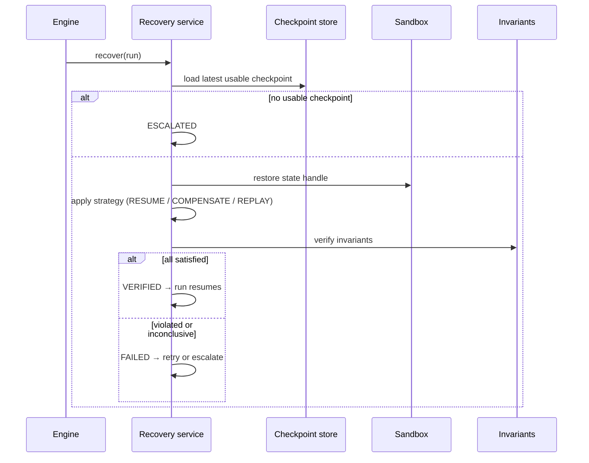

# FLOWSTATE AI — Architecture

| Field | Value |
| --- | --- |
| Status | Draft for hackathon build |
| Related | [PRD.md](PRD.md), [DOMAIN_MODEL.md](DOMAIN_MODEL.md), [STATE_MACHINES.md](STATE_MACHINES.md), [SECURITY.md](SECURITY.md) |

## 1. Principles

1. **The backend is the only executor.** The React console and any language model are
   clients. Neither drives Playwright, writes files, or reaches the network.
2. **State changes are transitions, never assignments.** Services call the transition
   table; accepted transitions emit audit events in the same transaction.
3. **Verification is separate from action.** "Did the click land?" and "did the business
   outcome happen?" are different questions with different answers.
4. **Ambiguity is a state, not an error.** `UNKNOWN` must be resolved by a probe.
5. **Determinism is designed in.** Injected clock, seeded RNG, stubbed network, no
   wall-clock sleeps in tests.
6. **Ports and adapters at the edges.** SQLite now, PostgreSQL later, without touching
   services.

## 2. System context



**Alan does not host FLOWSTATE.** Alan provides the cloud environment that builds and
runs this repository, the scheduled workflows that trigger chaos/regression runs, and the
artifact store that holds plans and test reports. The product's own persistence is
SQLite plus a local evidence store.

## Live execution delivery

The console starts ordinary runs with `background=true`. The API persists the run,
initial audit event, node projections, and an `ExecutionJob` row before acknowledging the
request. A process-managed worker pool executes up to four runs concurrently and admits
at most 32 queued/running runs per process. Persisted queued jobs are submitted after
restart. Jobs found in `RUNNING` state after a restart are not blindly retried: the run
is moved to `AWAITING_RECOVERY` with an `UNKNOWN` outcome requiring inspection.

The worker commits completed node state, its checkpoint, and associated audit events at
the same node boundary. The authenticated endpoint
`GET /api/v1/runs/{run_id}/events/stream` streams a versioned event envelope over SSE.
`sequence` is the run's existing audit sequence; `event_id` is the immutable audit event
ID. Clients send `Last-Event-ID` to resume and discard already-seen sequence numbers.
The existing run-detail request is the initial snapshot; events trigger refreshes of the
run, timeline, decisions, overview, and audit projections. Connections send heartbeats
and stop polling the database when the client disconnects.

This is a single-process application worker design, not a distributed queue or message
broker. SSE tails the durable SQL audit log at a bounded interval, so committed events
survive reconnects without a second event store. Capacity is enforced per process; use a
single API worker for the current SQLite deployment. A multi-process/tenant deployment
needs a shared worker-capacity policy and per-user authorization before it can claim
cross-user isolation. Non-background API callers and operations such as approval and
recovery remain synchronous; their events become visible after their request transaction
commits.

## 3. Components

### 3.1 Backend package layout (`backend/flowstate/`)

| Module | Responsibility |
| --- | --- |
| `main.py` | App factory, middleware (request id, redaction, error mapping), router wiring |
| `config.py` | `pydantic-settings` config from env; no defaults for secrets |
| `db/engine.py` | SQLite engine, WAL pragma, session factory, migration runner |
| `db/models.py` | SQLAlchemy 2.0 declarative tables mirroring the domain |
| `domain/enums.py` | Every enum from [DOMAIN_MODEL.md](DOMAIN_MODEL.md#3-enum-catalog) |
| `domain/schemas.py` | Pydantic v2 DTOs (API boundary + domain objects) |
| `domain/statemachine.py` | All transition tables and guards |
| `domain/policy.py` | `ActionPolicy`: allow-lists, authorization requirements, payment routing |
| `repositories/base.py` | `Repository[T]`, `UnitOfWork`, `EventStore` ports |
| `repositories/sqlite/` | SQLAlchemy-backed adapters |
| `repositories/memory.py` | In-memory adapters used by unit tests |
| `services/audit.py` | Canonical JSON, hash chain, append + verify |
| `services/workflows.py` | Workflow/version CRUD, publish validation |
| `services/learning.py` | Capture lifecycle, review, validation, generation and replay |
| `services/execution.py` | Step loop, pre/postconditions, probes, checkpoints |
| `services/chaos_service.py` | Scenario lifecycle, injection, invariant evaluation |
| `services/decision_service.py` | Minimum unresolved decision, evidence bundle, capability tokens |
| `services/recovery_service.py` | Checkpoint restore, compensation, verification |
| `services/regression_service.py` | Failure → regression spec, replay |
| `services/evidence_service.py` | Content-addressed writes, hashing, redaction |
| `capture/recording.py` | Raw-event contract, selector ranking, redaction, ambiguity rules, graph derivation |
| `capture/browser.py` | `playwright-v1` driver: navigation, locator resolution, postcondition waits, probes, screenshots |
| `capture/demo_app/` | Controlled invoice demo (static site + privacy-aware in-page recorder) served at `/demo-app/` |
| `services/chaos.py` | Fault scenarios, seeded injection and invariant verdicts |
| `sandbox/invoice.py` | Deterministic in-process invoice sandbox |
| `api/routers/*.py` | REST endpoints per aggregate, including `captures` |
| `api/errors.py` | Problem+JSON error envelope |

### 3.2 Persistence and the repository port

The service layer depends on protocols, not SQLAlchemy:

```python
class Repository[T](Protocol):
    def get(self, id: UUID) -> T | None: ...
    def list(self, **filters: Any) -> Sequence[T]: ...
    def add(self, entity: T) -> T: ...
    def update(self, entity: T) -> T: ...

class EventStore(Protocol):
    def append(self, run_id: UUID, events: Sequence[ExecutionEvent]) -> None: ...
    def read(self, run_id: UUID, *, after_seq: int = -1) -> Sequence[ExecutionEvent]: ...

class UnitOfWork(Protocol):
    workflows: Repository[Workflow]
    versions: Repository[WorkflowVersion]
    runs: Repository[ExecutionRun]
    events: EventStore
    # ...
    def __enter__(self) -> UnitOfWork: ...
    def __exit__(self, *exc: object) -> None: ...   # commit or rollback
```

`EventStore` intentionally exposes **no update or delete**. Append-only is a type-level
guarantee, not a convention.

Swapping SQLite for PostgreSQL means adding `repositories/postgres/` and changing the
factory in `db/engine.py`. No service, router or test changes.

### 3.3 Determinism kit

| Concern | Mechanism |
| --- | --- |
| Time | `Clock` protocol: `SystemClock` in prod, `FrozenClock` in tests; never `datetime.now()` in services |
| Randomness | `RandomSource` seeded from `ExecutionRun.seed` |
| Retries / backoff | `Sleeper` protocol; `InstantSleeper` in tests |
| Network | Playwright routes stub the demo origin; no other origin is reachable |
| Ordering | Ordinal-based action order; event `seq` is a total order per run |
| IDs | `IdFactory`; `SequentialIdFactory` in tests for stable snapshots |

## 4. Key flows

### 4.1 Learn



The recorder produces **candidate** actions and never publishes. Validation resolves each
selector against the live demo and blocks publish while any selector is missing or
ambiguous. Replay is a normal engine run, so postconditions, timeouts, `UNKNOWN`
reconciliation, checkpoints and the audit chain all apply.

### 4.2 Execute



### 4.3 Chaos

Fault injection happens at the **Playwright boundary**, not inside the demo app, so the
same injector works for any allow-listed target. A `FaultScenario` is compiled into a
route handler (or a response transformer) that is armed only for the target action's
window. The injector reports `fault_applied` before the run continues, which is what makes
`INJECTING → OBSERVING` honest.

### 4.4 Decide



"Minimum unresolved decision" is computed as the **lowest ordinal** step that is blocked
on authorization and whose inputs are already resolved. Higher blocked steps are not
shown, because they may become moot depending on this answer.

### 4.5 Recover



## 5. HTTP API surface

All routes are under `/api/v1`. Errors use `application/problem+json`.

| Method | Path | Purpose |
| --- | --- | --- |
| `GET` | `/healthz` | Liveness + build info |
| `GET` | `/readyz` | DB + evidence store reachable |
| `POST` | `/captures` | Start a recording session |
| `GET` | `/captures/{id}` | Capture status + candidate actions |
| `POST` | `/captures/{id}/pause`, `/resume`, `/stop` | Recording lifecycle |
| `POST` | `/captures/{id}/events` | Ingest structured recorded events |
| `PATCH` | `/captures/{id}/actions/{actionId}` | Edit or resolve a candidate |
| `POST` | `/captures/{id}/validate` | Resolve every selector on the demo |
| `POST` | `/captures/{id}/workflow` | Save a draft or publish a version |
| `POST` | `/captures/{id}/replay` | Execute the saved workflow in Chromium |
| `GET/POST` | `/workflows` | List / create |
| `GET` | `/workflows/{id}` | Detail + versions |
| `GET/POST` | `/workflows/{id}/versions` | List / fork a draft |
| `POST` | `/workflows/{id}/versions/{v}/publish` | Validate + publish |
| `GET/POST` | `/runs` | List / start a run |
| `GET` | `/runs/{id}` | Projection |
| `GET` | `/runs/{id}/events` | Ordered audit log |
| `GET` | `/runs/{id}/events/verify` | Recompute hash chain |
| `GET/POST` | `/scenarios` | List / create fault scenario |
| `POST` | `/scenarios/{id}/run` | Execute a fault run only |
| `POST` | `/scenarios/{id}/evaluate` | Authorized baseline + fault run + derived report |
| `GET` | `/scenarios/{id}/report` | Recomputed baseline/fault report |
| `GET` | `/runs/{id}/invariants` | Verdicts + evidence |
| `GET` | `/decisions` | Open decisions (inbox) |
| `GET` | `/decisions/{id}` | Decision + evidence bundle |
| `POST` | `/decisions/{id}/approve` | Human approval → capability token |
| `POST` | `/decisions/{id}/deny` | Human denial |
| `POST` | `/runs/{id}/recover` | Start a recovery attempt |
| `GET` | `/runs/{id}/recoveries` | Attempts and verification |
| `POST` | `/runs/{id}/regression` | Generate a regression test |
| `GET/POST` | `/regression-tests` | List / replay |

OpenAPI is generated by FastAPI and consumed by the frontend's typed client.

## 6. Frontend architecture

- **Stack:** React 19 + TypeScript + Vite, TanStack Query for server state, React Router
  for navigation. No global state library: server state is the state.
- **Typed client:** generated from `/openapi.json` at build time; a hand-written thin
  wrapper adds auth headers and problem+json error mapping.
- **Feature folders:** `workflows`, `runs`, `chaos`, `decisions`, `recovery`,
  `regression`. Each owns its components, hooks and types.
- **Design:** dark-first developer console, monospace for identifiers and event logs,
  status always encoded by icon + text + colour (never colour alone), keyboard-navigable,
  responsive down to 380 px.
- **Live run view:** subscribes to `/runs/{id}/events/stream`, resumes from the latest
  run sequence after reconnect, and invalidates server-state projections as events arrive.
  The UI never computes a verdict; it renders what the backend reports.

## 7. Alan integration (verified capabilities)

These are the Alan tools actually available in this environment. FLOWSTATE uses them for
delivery, not as a runtime dependency.

| Alan tool | Use |
| --- | --- |
| `create_plan` | Persist the implementation plan as an in-product artifact |
| `create_document_artifact` | Publish the architecture/PRD summary for reviewers |
| `create_test_report` + `publish_capture` | Store acceptance evidence with screenshots inline |
| `add_team_repository` | Connect the GitHub repo to the team |
| `set_environment_scripts` / `build_environment_image` / `test_environment_build` | Reproducible cloud environment for the demo |
| `create_workflow` / `execute_workflow` | Scheduled nightly chaos + regression runs |
| `create_skill` | The `flowstate-operator` team Skill |
| Custom MCP connector | Verified typed runtime tools through the adapter |

**Runtime integration:** Alan supports custom MCP connectors (Settings → Plugins → MCP)
and team Skills. FLOWSTATE exposes a narrow streamable-HTTP/stdio MCP server and a
`flowstate-alan` CLI over one typed operations boundary. Consequential calls require a
two-step confirmation token; backend authentication, authorization, policy and
preconditions remain authoritative. The adapter does not expose workflow editing, human
decision approval, arbitrary HTTP or shell. Connector registration itself is UI-only in
this environment.

**Non-assumptions:** Alan is not the application host and does not provide the product's
database. The product runs standalone; Alan is the factory around it and an authenticated
client through the MCP boundary.

## 8. Deliberate trade-offs

| Decision | Why | Cost |
| --- | --- | --- |
| In-process engine, not a queue | Determinism and debuggability for a hackathon; no Redis | No horizontal scale; documented as MVP limit |
| Event-sourced runs | Audit trail and replay for free; recovery needs history anyway | Projection code and event schema discipline |
| SQLite + SQLAlchemy | Zero-ops local persistence, real path to Postgres | Single-writer constraint |
| Process-level sandbox, not containers | Docker is unavailable in this environment | Weaker isolation; mitigated by egress allow-list and a demo-only target |
| Deterministic extraction before LLM | Testability and the "LLM has no authority" rule | Less general than an LLM-first recorder |
