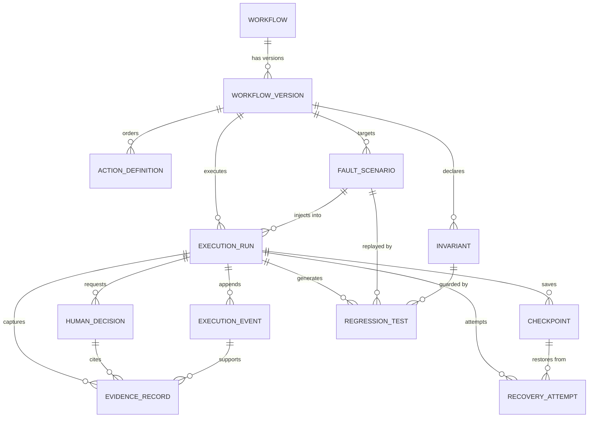

# FLOWSTATE AI — Domain Model

| Field | Value |
| --- | --- |
| Status | Draft for hackathon build |
| Related | [ARCHITECTURE.md](ARCHITECTURE.md), [STATE_MACHINES.md](STATE_MACHINES.md) |

The domain is **event-sourced at the run level**: `ExecutionEvent` is the source of
truth for what happened, and `ExecutionRun` is a projection of it. Everything else is
configuration or evidence attached to that history.

## 1. Entity map



## 2. Entities

Every entity has `id: UUID`, `created_at: datetime` (UTC), and is validated by a
Pydantic v2 model at the boundary. Timestamps come from an injected clock.

### 2.1 `Workflow`

The stable, named identity of a process. Holds no executable content itself.

| Field | Type | Notes |
| --- | --- | --- |
| `slug` | `str` | Unique, URL-safe |
| `name` | `str` | Human label |
| `description` | `str` | What business outcome it produces |
| `owner` | `str` | Acting user or agent id |
| `current_version_id` | `UUID \| None` | Points at the latest published version |
| `archived_at` | `datetime \| None` | Soft delete only |

**Invariants:** `slug` immutable after creation; `current_version_id` must reference a
`PUBLISHED` version of this workflow.

### 2.2 `WorkflowVersion`

An immutable snapshot of the workflow's executable definition.

| Field | Type | Notes |
| --- | --- | --- |
| `workflow_id` | `UUID` | Parent |
| `version` | `int` | Monotonic per workflow, starts at 1 |
| `status` | `VersionStatus` | `DRAFT → PUBLISHED → DEPRECATED → ARCHIVED` |
| `content_hash` | `str` | SHA-256 over canonical JSON of actions + invariants |
| `parent_version_id` | `UUID \| None` | Lineage when derived by editing |
| `published_at` | `datetime \| None` | Set exactly once |

**Invariants:** content is write-once after `PUBLISHED`; `(workflow_id, version)` is
unique; a version may only be published if every action validates.

### 2.3 `ActionDefinition`

One step in a version. This is where preconditions, postconditions and authorization
live.

| Field | Type | Notes |
| --- | --- | --- |
| `workflow_version_id` | `UUID` | Parent |
| `ordinal` | `int` | Execution order, contiguous from 0 |
| `kind` | `ActionKind` | See enum catalog |
| `label` | `str` | Human-readable intent |
| `target` | `TargetSelector` | Ordered selector strategies + expected role/name |
| `input` | `dict[str, Any]` | Typed payload, validated per kind |
| `preconditions` | `list[Condition]` | Must hold before acting |
| `postconditions` | `list[Condition]` | Must hold after acting to claim success |
| `side_effect_class` | `SideEffectClass` | `READ_ONLY`, `IDEMPOTENT`, `COMPENSABLE`, `IRREVERSIBLE` |
| `requires_authorization` | `bool` | Forces the human-decision path |
| `timeout_ms` | `int` | Per-action budget |
| `retry` | `RetryPolicy` | Max attempts, backoff, retry-on |

**Invariants:** `ordinal` unique within a version; an `IRREVERSIBLE` action must declare
at least one postcondition and must be `requires_authorization` **or** explicitly
allow-listed in `ActionPolicy`; a `PAYMENT_SIMULATED` action may only target the demo
origin.

### 2.4 `ExecutionRun`

The projection of one attempt to execute a version.

| Field | Type | Notes |
| --- | --- | --- |
| `workflow_version_id` | `UUID` | Must be `PUBLISHED` at start |
| `status` | `RunStatus` | See [STATE_MACHINES.md](STATE_MACHINES.md) |
| `trigger` | `RunTrigger` | `MANUAL`, `CHAOS`, `SCHEDULED`, `REGRESSION` |
| `seed` | `int` | Drives all determinism |
| `current_ordinal` | `int` | Furthest action started |
| `fault_scenario_id` | `UUID \| None` | Set for chaos runs |
| `capture_session_id` | `UUID \| None` | Provenance for a learned replay |
| `driver` | `str` | `simulated-v1` or `playwright-v1` |
| `parent_run_id` | `UUID \| None` | Set for recovery/regression replays |
| `verdict` | `RunVerdict \| None` | `VERIFIED`, `FAILED`, `CANCELLED`, `TIMED_OUT` |
| `failure` | `FailureDetail \| None` | Code, message, action ordinal, event id |
| `started_at` / `ended_at` | `datetime \| None` | From injected clock |

**Invariants:** `verdict = VERIFIED` requires a terminal verification event and zero
unresolved `UNKNOWN` action outcomes; `status` changes only through the transition table.

### 2.4a `CaptureSession` and `CapturedAction`

A controlled recording and its ordered candidate actions. Learning data is intentionally
separate from a `WorkflowVersion` until a human saves it.

| `CaptureSession` field | Type | Notes |
| --- | --- | --- |
| `status` | `CaptureStatus` | `RECORDING`, `PAUSED`, `REVIEW`, `VALIDATED`, `SAVED`, `FAILED` |
| `demo_url` | `str` | Must be the controlled `/demo-app` origin |
| `workflow_id` / `workflow_version_id` | `UUID \| None` | Set only after saving |
| `event_count` | `int` | Ordered events ingested |
| `validation` | `dict` | Last Playwright selector report |
| `created_by` | `str` | Human recorder |

| `CapturedAction` field | Type | Notes |
| --- | --- | --- |
| `ordinal` | `int` | Contiguous per session |
| `kind` | `str` | `CLICK`, `TYPE`, `SELECT`, `SUBMIT`, `NAVIGATE` |
| `selector` | `list[dict]` | Ranked locators; role+name first |
| `input_param` / `input_value` | `str \| None` | Reusable parameter and non-sensitive default |
| `page_before` / `page_after` | `dict` | Declarative page transition |
| `expected_result` / `observed_result` | `str` | Human-readable outcome |
| `preconditions` / `postconditions` | `list[dict]` | Structured checks |
| `ambiguous` / `ambiguity_reason` | `bool` / `str` | Blocks save until resolved |
| `resolution` | `dict` | Human acceptance note |

**Invariants:** a sensitive value is never stored; `ordinal` is unique per session; an
unresolved ambiguity or a failed selector validation blocks publish; saving an already
saved session creates a new `WorkflowVersion` rather than mutating the old one.

### 2.5 `ExecutionEvent`

Append-only, hash-linked audit record. **The** source of truth.

| Field | Type | Notes |
| --- | --- | --- |
| `run_id` | `UUID` | Parent run |
| `seq` | `int` | Contiguous from 0 per run |
| `type` | `EventType` | See enum catalog |
| `actor` | `Actor` | `SYSTEM`, `AGENT`, `HUMAN`, `POLICY` + actor id |
| `action_ordinal` | `int \| None` | Step the event concerns |
| `payload` | `dict[str, Any]` | Event-specific, canonicalised |
| `prev_hash` | `str` | `""` for genesis |
| `hash` | `str` | `sha256(prev_hash + canonical_json(payload) + type + seq)` |
| `recorded_at` | `datetime` | Injected clock |

**Invariants:** append-only (no update/delete path exists in the repository port);
`seq` gap-free; `hash` recomputable; no event payload may contain a secret.

### 2.6 `FaultScenario`

A declarative, reproducible failure injection.

| Field | Type | Notes |
| --- | --- | --- |
| `workflow_version_id` | `UUID` | Target |
| `name` | `str` | |
| `target_action_id` | `UUID` | Which step to break |
| `fault_type` | `FaultType` | `TIMEOUT`, `HTTP_500`, `DUPLICATE_RESPONSE`, `LATENCY`, `PARTIAL_COMMIT`, `STALE_READ`, `NETWORK_DROP` |
| `parameters` | `dict[str, Any]` | e.g. `{"delay_ms": 3000}` |
| `seed` | `int` | Reproducibility |
| `status` | `ScenarioStatus` | `DRAFT → READY → INJECTING → OBSERVING → COMPLETED` |
| `invariant_ids` | `list[UUID]` | Evaluated at completion |

**Invariants:** a scenario is only `READY` if its target action exists in the version and
its parameters validate for the fault type.

### 2.7 `Invariant`

A predicate that must hold, independent of whether an action "looked" successful.

| Field | Type | Notes |
| --- | --- | --- |
| `workflow_version_id` | `UUID` | Scope |
| `name` / `description` | `str` | |
| `kind` | `InvariantKind` | `POSTCONDITION`, `HISTORY`, `CROSS_ACTION`, `TERMINAL_STATE` |
| `expression` | `str` | Declarative predicate over the run projection (restricted DSL) |
| `severity` | `Severity` | `CRITICAL`, `MAJOR`, `MINOR` |
| `applies_to_action_id` | `UUID \| None` | Optional narrowing |

**Verdicts:** `SATISFIED`, `VIOLATED`, `INCONCLUSIVE`. `INCONCLUSIVE` (missing evidence or
an unresolved `UNKNOWN`) is never a pass.

### 2.8 `EvidenceRecord`

Content-addressed proof attached to a run or a decision.

| Field | Type | Notes |
| --- | --- | --- |
| `run_id` | `UUID` | |
| `event_id` | `UUID \| None` | Supporting event |
| `kind` | `EvidenceKind` | `SCREENSHOT`, `DOM_SNAPSHOT`, `HTTP_TRACE`, `LOG`, `INVARIANT_REPORT`, `DECISION_BUNDLE` |
| `uri` | `str` | Local artefact path (never a remote URL) |
| `sha256` | `str` | Integrity check |
| `mime_type` | `str` | |
| `metadata` | `dict[str, Any]` | Redacted |
| `captured_at` | `datetime` | |

**Invariants:** the file at `uri` must hash to `sha256`; evidence is immutable once
written; evidence never contains credentials or full payment data.

### 2.9 `HumanDecision`

The minimum unresolved decision that blocks a run.

| Field | Type | Notes |
| --- | --- | --- |
| `run_id` | `UUID` | |
| `action_ordinal` | `int` | The blocking step |
| `question` | `str` | One decision, phrased actionably |
| `options` | `list[DecisionOption]` | `{value, label, consequence}` |
| `recommended_option` | `str \| None` | Advisory only |
| `reason` | `str` | Why policy could not decide |
| `policy_citation` | `str` | Rule that forced escalation |
| `evidence_ids` | `list[UUID]` | What the human sees |
| `status` | `DecisionStatus` | `REQUESTED → NOTIFIED → AUTHORIZED \| DENIED \| EXPIRED → APPLIED` |
| `decided_by` | `str \| None` | Human identity |
| `decided_at` / `expires_at` | `datetime \| None` | |
| `capability_token_id` | `UUID \| None` | Issued on approval |

**Invariants:** exactly one open decision per `(run_id, action_ordinal)`; a token is
single-use and bound to `(run_id, action_ordinal, decision_id)`; approval cannot be
inferred from an LLM message.

### 2.10 `Checkpoint`

A restorable point in a run.

| Field | Type | Notes |
| --- | --- | --- |
| `run_id` | `UUID` | |
| `event_seq` | `int` | Audit offset at capture |
| `action_ordinal` | `int` | Completed through |
| `kind` | `CheckpointKind` | `PRE_ACTION`, `POST_ACTION`, `SAFE_POINT` |
| `state_uri` | `str` | Serialised sandbox state handle |
| `state_hash` | `str` | Integrity |

**Invariants:** `event_seq` must reference an existing event in the run; checkpoints are
immutable.

### 2.11 `RecoveryAttempt`

An attempt to restore and prove recovery.

| Field | Type | Notes |
| --- | --- | --- |
| `run_id` | `UUID` | |
| `checkpoint_id` | `UUID` | Restore point |
| `strategy` | `RecoveryStrategy` | `RESUME`, `COMPENSATE`, `REPLAY`, `ESCALATE` |
| `status` | `RecoveryStatus` | `PLANNED → APPLYING → APPLIED → VERIFIED \| FAILED → ESCALATED` |
| `steps` | `list[RecoveryStep]` | Each with its own outcome |
| `verification_event_id` | `UUID \| None` | Required for `VERIFIED` |

**Invariants:** `VERIFIED` requires a verification event whose invariant verdicts are all
`SATISFIED`; `APPLIED` is never reported to the user as recovered.

### 2.12 `RegressionTest`

A durable, deterministic reproduction of a failure.

| Field | Type | Notes |
| --- | --- | --- |
| `source_run_id` | `UUID` | Where it came from |
| `fault_scenario_id` | `UUID \| None` | |
| `invariant_id` | `UUID \| None` | What it guards |
| `name` | `str` | |
| `spec` | `dict[str, Any]` | Workflow version, seed, scenario, expected verdict |
| `status` | `RegressionStatus` | `DRAFT → ACTIVE → PASSING \| FAILING → QUARANTINED` |
| `last_run_at` / `last_result` | `datetime \| None` / `str \| None` | |

**Invariants:** a regression test's `spec` pins the workflow version and seed; replaying
it must not depend on wall-clock time or live network.

## 3. Enum catalog

```python
class VersionStatus(StrEnum):     DRAFT; PUBLISHED; DEPRECATED; ARCHIVED
class RunStatus(StrEnum):         PENDING; RUNNING; AWAITING_DECISION; AWAITING_RECOVERY;
                                  VERIFYING; SUCCEEDED; FAILED; CANCELLED; TIMED_OUT
class RunVerdict(StrEnum):        VERIFIED; FAILED; CANCELLED; TIMED_OUT
class ActionState(StrEnum):       PENDING; STARTED; SUCCEEDED; FAILED; UNKNOWN;
                                  CONFIRMED; COMPENSATED; SKIPPED
class SideEffectClass(StrEnum):   READ_ONLY; IDEMPOTENT; COMPENSABLE; IRREVERSIBLE
class ActionKind(StrEnum):        NAVIGATE; CLICK; TYPE; SELECT; SUBMIT; WAIT_FOR;
                                  ASSERT; EXTRACT; AUTHORIZE; PAYMENT_SIMULATED; API_CALL
class EventType(StrEnum):         RUN_CREATED; RUN_STARTED; ACTION_STARTED; ACTION_SUCCEEDED;
                                  ACTION_FAILED; ACTION_UNKNOWN; ACTION_CONFIRMED;
                                  PRECONDITION_FAILED; POSTCONDITION_FAILED;
                                  DECISION_REQUESTED; DECISION_GRANTED; DECISION_DENIED;
                                  DECISION_EXPIRED; CHECKPOINT_SAVED; FAULT_INJECTED;
                                  INVARIANT_EVALUATED; RECOVERY_STARTED; RECOVERY_APPLIED;
                                  RUN_VERIFIED; RUN_FAILED; RUN_CANCELLED
class FaultType(StrEnum):         TIMEOUT; HTTP_500; DUPLICATE_RESPONSE; LATENCY;
                                  PARTIAL_COMMIT; STALE_READ; NETWORK_DROP
class ScenarioStatus(StrEnum):    DRAFT; READY; INJECTING; OBSERVING; COMPLETED
class InvariantKind(StrEnum):     POSTCONDITION; HISTORY; CROSS_ACTION; TERMINAL_STATE
class Severity(StrEnum):          CRITICAL; MAJOR; MINOR
class InvariantVerdict(StrEnum):  SATISFIED; VIOLATED; INCONCLUSIVE
class DecisionStatus(StrEnum):    REQUESTED; NOTIFIED; AUTHORIZED; DENIED; EXPIRED; APPLIED
class CheckpointKind(StrEnum):    PRE_ACTION; POST_ACTION; SAFE_POINT
class RecoveryStrategy(StrEnum):  RESUME; COMPENSATE; REPLAY; ESCALATE
class RecoveryStatus(StrEnum):    PLANNED; APPLYING; APPLIED; VERIFIED; FAILED; ESCALATED
class RegressionStatus(StrEnum):  DRAFT; ACTIVE; PASSING; FAILING; QUARANTINED
class EvidenceKind(StrEnum):      SCREENSHOT; DOM_SNAPSHOT; HTTP_TRACE; LOG;
                                  INVARIANT_REPORT; DECISION_BUNDLE
```

## 4. Cross-entity invariants

These are enforced in services **and** asserted by tests; they are the correctness core
of the product.

| ID | Invariant |
| --- | --- |
| DX-1 | A run may only start against a `PUBLISHED` version |
| DX-2 | Every run status change has a matching `ExecutionEvent` |
| DX-3 | `SUCCEEDED` requires every action postcondition verified and every invariant `SATISFIED` |
| DX-4 | An `UNKNOWN` action outcome blocks terminal success until a confirming event exists |
| DX-5 | `HumanDecision.AUTHORIZED` is the only source of a capability token |
| DX-6 | A capability token is single-use and cannot outlive its decision |
| DX-7 | `RecoveryAttempt.VERIFIED` requires a passing verification event |
| DX-8 | Evidence bytes match their recorded `sha256` |
| DX-9 | No event, evidence record or log line contains a secret |
| DX-10 | Published `WorkflowVersion` content is immutable |
