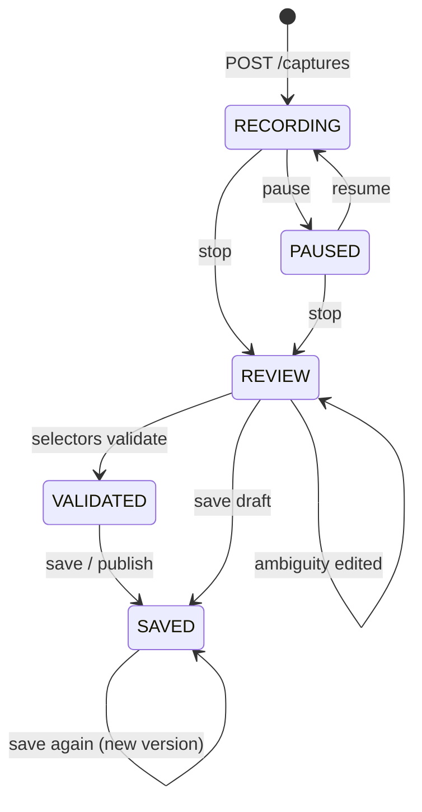

# FLOWSTATE AI — Workflow Learning and Browser Capture

| Field | Value |
| --- | --- |
| Status | Implemented for the controlled invoice demo |
| Related | [ACCEPTANCE_CRITERIA.md](ACCEPTANCE_CRITERIA.md), [SECURITY.md](SECURITY.md), [TEST_STRATEGY.md](TEST_STRATEGY.md) |

FLOWSTATE learns workflows from a **controlled website we own**, not from arbitrary
sites. The demo is a deterministic invoice-processing application served at
`/demo-app/`. Recording, validation and replay are backend-only; the console embeds the
demo and renders the reviewed result.

> This is not general-purpose website understanding. It understands the demo's
> declarative page state and ranked accessibility locators. It does not infer intent from
> arbitrary sites, and it refuses to guess when a recording is ambiguous.

## 1. Controlled demo

`backend/flowstate/capture/demo_app/` contains the static site and its privacy-aware
recorder. It has no network calls, no authentication and no financial side effects.

| Fixture | Supplier | Invoice | PO | Expected validation |
| --- | --- | --- | --- | --- |
| `INV-1001` | `SUP-77` | $1,250.00 | $1,250.00 | `VALID` |
| `INV-1002` | `SUP-88` | $999.00 | $800.00 | `DISCREPANCY` |
| `INV-1003` | `SUP-77` | $4,500.00 | $4,500.00 | `VALID` |

The page exposes its state through `data-page`, `data-state`, `data-invoice-id` and other
stable attributes. The recorder uses those attributes for the observed result, never by
parsing free text with a model.

`?variant=changed` deliberately changes ids, labels, accessible names and test ids. It is
used by deterministic tests to prove that selector drift fails safely.

## 2. Capture lifecycle



Events are posted from the embedded demo to the console, which forwards batches to
`POST /captures/{id}/events`. Events are rejected unless the session is `RECORDING`, and a
session is capped at `FLOWSTATE_CAPTURE_MAX_EVENTS` (default 80).

## 3. Captured data

Each candidate action stores:

| Field | Meaning |
| --- | --- |
| `kind` | `CLICK`, `TYPE`, `SELECT`, `SUBMIT` or `NAVIGATE` |
| `selector` | Ranked locator strategies with scores |
| `accessible_name` | The accessible name used for role+name locators |
| `input_param` | Reusable workflow input such as `supplier_id` or `invoice_id` |
| `input_value` | Non-sensitive captured value (used as the replay default) |
| `page_before` / `page_after` | Route, page, heading and declarative state |
| `expected_result` / `observed_result` | What should happen and what was seen |
| `preconditions` / `postconditions` | Structured page-state checks |
| `failure_conditions` | Known ways this step can fail |
| `redacted_fields` | Values removed before persistence |
| `ambiguous` / `ambiguity_reason` | Why a human must review the step |
| `resolution` | Human acceptance note and decision |

### Selector ranking

1. Role + accessible name (score 100)
2. Label (95)
3. Test id (90)
4. Placeholder (80)
5. Visible text (70)
6. CSS selector (50)

A candidate that matches more than one element is never selected. Validation reports
`SELECTOR_NOT_FOUND` when no candidate resolves uniquely and `SELECTOR_AMBIGUOUS` when a
candidate matches several elements.

### Redaction

Password, token, secret, authorization, API-key, card, CVV, IBAN, account and SSN-shaped
fields are treated as sensitive. Their values are replaced before the event leaves the
page and are never persisted. URLs are stored without query strings so a capture URL
cannot carry a token. The same redaction applies to run inputs, audit payloads and
checkpoints.

## 4. Ambiguity rules

A candidate is marked ambiguous and **blocks saving** until a human acts when:

- only a CSS selector is available;
- a click produces no observable page transition or state change;
- a sensitive value was redacted and no safe parameter exists;
- an identifier-shaped value was typed without a reusable parameter.

The review UI offers two explicit paths: edit the action, or accept the ambiguity with a
note. There is no "assume and continue" path.

Financial-shaped labels (`submit`, `approve`, `pay`, `transfer`, `delete`, `confirm`,
`authorize`) become `HUMAN_DECISION` nodes with `requires_authorization = true`. The
engine pauses and never auto-approves them.

## 5. Generated workflow

The reviewed actions become a versioned typed graph:

```text
START → VALIDATION(inputs) → ACTION(NAVIGATE) → ACTION(captured_1) → … → END
```

- `channel = BROWSER` for browser nodes; the only registered drivers are `SIMULATED` and
  `BROWSER`.
- `target` contains the controlled URL, ranked locator list and accessible name.
- `input` contains a literal value or `value_from: inputs.<param>`, plus a declarative
  `wait_for` page-state predicate. No field contains executable code.
- `postconditions` are ordinary condition expressions over `page.*`, evaluated after the
  browser action. A completed Playwright call without a passing postcondition is a
  failure.
- The workflow input schema is derived from parameterized fields and enforced before a
  replay starts.
- A terminal invariant requires an observable validation result.

Saving a draft is allowed after ambiguities are resolved. Publishing requires a passing
selector validation. Saving again creates a new immutable version.

## 6. Replay semantics

Replay is a normal engine run through `playwright-v1`. It reuses the engine's ordering,
retry, timeout, postcondition, checkpoint, audit-chain and terminal-status rules. A
published learned version can also be started from Workflow Studio / `POST /runs` with
its declared inputs; that path uses the same driver and links the run back to its capture
session.

- A selector that no longer resolves fails the node with `SELECTOR_NOT_FOUND` and the run
  is `FAILED`; later nodes are skipped.
- An action that completes but does not produce the expected page state is `UNKNOWN`, then
  reconciled with a read-only page probe. If the probe cannot confirm the effect, the run
  is `AWAITING_RECOVERY`, never `SUCCEEDED`.
- A timeout after the action may have executed is never blindly retried.
- Screenshots are stored content-addressed as `EvidenceRecord`s and linked to the run.
  `GET /runs/{id}/evidence/{evidenceId}` verifies the hash before serving the file.
- The run is visible in the Execution Inspector with its ordered event timeline.

Browser-backed runs cannot be resumed mid-page because live page state is not persisted.
An approval instead rebuilds a fresh browser session and replays the workflow from ordinal
zero, carrying the existing grants forward so the approved node executes exactly once.
Recovery strategies that require a mid-page resume are still rejected explicitly
(`BROWSER_RESUME_UNSUPPORTED`).

## 7. API

| Method | Path | Purpose |
| --- | --- | --- |
| `GET/POST` | `/api/v1/captures` | List / start a recording |
| `GET` | `/api/v1/captures/{id}` | Session, candidates, validation, recent replays |
| `POST` | `/api/v1/captures/{id}/pause`, `/resume`, `/stop` | Recording lifecycle |
| `POST` | `/api/v1/captures/{id}/events` | Ingest recorded interactions |
| `PATCH` | `/api/v1/captures/{id}/actions/{actionId}` | Edit or resolve a candidate |
| `POST` | `/api/v1/captures/{id}/validate` | Resolve every selector with Playwright |
| `POST` | `/api/v1/captures/{id}/workflow` | Save a draft or publish a version |
| `POST` | `/api/v1/captures/{id}/replay` | Execute the saved workflow with inputs |
| `GET` | `/api/v1/captures/{id}/runs` | Replays for this session |
| `GET` | `/api/v1/runs/{id}/evidence/{evidenceId}` | Hash-checked screenshot/evidence |

All routes except health and the demo site require the configured bearer token.

## 8. Acceptance demonstration

1. Open **Learning Studio**, start a recording.
2. In the embedded demo, enter supplier `SUP-77` and invoice `INV-1001`, click **Load
   invoice**, then **Validate invoice**.
3. Stop recording and review the four typed actions and ranked locators.
4. Validate selectors, then save and publish the workflow.
5. Replay with a different permitted fixture, for example `SUP-77` / `INV-1003`; the run
   must be `SUCCEEDED` and `VERIFIED`.
6. Replay with **Changed layout** selected; the run must fail with `SELECTOR_NOT_FOUND`
   and must not be reported as success.

This journey is exercised by `frontend/e2e/learning.spec.ts` and
`backend/tests/browser/test_playwright_capture.py`.

## 9. Known limitations

- Only the controlled `/demo-app` origin can be recorded or replayed. There is no
  general-purpose website understanding.
- Only text inputs, selects, clicks, links and submit buttons are captured. Only fields
  whose value changes are recorded; drag and drop, file upload, canvas, multi-tab flows,
  browser dialogs and cross-origin iframes are not supported.
- Page transitions are detected from declarative attributes and hash routes, not from
  arbitrary visual diffs.
- The recorder observes the top document. Shadow DOM and nested same-origin iframes are
  not descended into.
- Selector uniqueness is checked at capture validation time. A page can still change
  between validation and replay, in which case replay fails safely and must be re-recorded.
- Browser-backed runs cannot resume mid-page. A decision approval safely replays from
  ordinal zero in a fresh browser session; other mid-page resumes are rejected.
- Screenshots are full-viewport PNGs; no video, network trace or console-log evidence is
  captured yet.
- Authentication, credentials and real financial actions are intentionally out of scope.