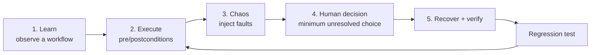

# FLOWSTATE AI — Product Requirements Document

| Field | Value |
| --- | --- |
| Status | Draft for hackathon build |
| Owner | Adwika Vishal |
| Version | 0.1 |
| Last updated | 2026-10-26 |
| Related | [ARCHITECTURE.md](ARCHITECTURE.md), [DOMAIN_MODEL.md](DOMAIN_MODEL.md), [ACCEPTANCE_CRITERIA.md](ACCEPTANCE_CRITERIA.md) |

---

## 1. Problem

Teams automate operational workflows — onboarding, refunds, provisioning, reconciliation
— with scripts and browser bots that have no memory of *why* they do what they do and no
way to prove they worked. Four failures recur:

1. **Fragile automation.** A recorded macro breaks silently when the page changes, and
   the failure surfaces downstream as bad data.
2. **Unverifiable success.** A script reports "done" because a click returned HTTP 200,
   not because the business outcome happened.
3. **Unmodelled human steps.** The one approval that a human must make is buried inside
   a script, so the automation either stalls or — worse — guesses.
4. **No learning from failure.** A production incident is fixed by hand and never becomes
   a test, so it recurs.

Existing tools solve one slice each: recorders record, RPA platforms run, chaos tools
break infrastructure, and workflow engines model approvals. None close the loop from
*observed workflow* → *verified execution* → *proven failure* → *permanent regression
test*.

## 2. Vision

**FLOWSTATE makes a workflow a verifiable state machine.**

A workflow is learned by observation, stored as versioned structured actions, executed
against a controlled sandbox with explicit preconditions and postconditions, stress-tested
with deterministic fault injection, and paused only for the *minimum* unresolved human
decision. Every run produces an evidence-backed audit trail; every failure produces a
regression test.

## 3. Target users

| Persona | Need |
| --- | --- |
| **Automation engineer** (primary) | Turn a manual process into something that can be re-run and trusted |
| **Reliability engineer** | Prove a workflow survives realistic failures, and get alerted when invariants break |
| **Operations lead** | Approve only the decisions that genuinely require a human, with evidence in front of them |
| **Reviewer / auditor** | Reconstruct exactly what happened, in order, with evidence |

Primary deployment for the hackathon is **single-tenant, local, developer-operated**.

## 4. The five capabilities, as one product

The product is deliberately **one loop**, not five tools. Each capability consumes the
artefacts of the previous one.

| # | Capability | Input | Output |
| --- | --- | --- | --- |
| 1 | **Workflow learning** | A recorded browser session against the demo app | `WorkflowVersion` containing ordered `ActionDefinition`s with selectors, preconditions, postconditions |
| 2 | **Workflow execution** | A published `WorkflowVersion` | `ExecutionRun` + append-only `ExecutionEvent` history |
| 3 | **Chaos testing** | A workflow + a `FaultScenario` | `Invariant` verdicts and `EvidenceRecord`s |
| 4 | **Human bottleneck resolution** | A run blocked on an authorization | `HumanDecision` with an evidence bundle; run resumes on approval |
| 5 | **Recovery + feedback** | A failed or `UNKNOWN` run + a `Checkpoint` | `RecoveryAttempt` (verified) and a `RegressionTest` |

### 4.1 Workflow learning

- Capture a user's actions in a controlled browser session (Playwright) against the
  bundled demonstration application.
- Convert the raw capture into ordered `ActionDefinition`s: action kind, target
  selector strategy, input payload, preconditions, postconditions, and whether the
  action is *reversible*, *idempotent*, or *requires authorization*.
- The conversion is **advisory**. Selectors and postconditions are validated against the
  live page before a version can be published; an LLM may propose a semantic label but
  cannot mark a step verified.
- Produce a new immutable `WorkflowVersion`; versions are never edited in place.

### 4.2 Workflow execution

- Execute only a **published** `WorkflowVersion`.
- Evaluate each action's preconditions before acting and postconditions after acting.
- Record every transition as a hash-linked `ExecutionEvent`.
- An action whose external outcome cannot be determined ends in `UNKNOWN`; the engine
  must run a **confirming probe** before the run can continue or succeed.
- Terminal `SUCCEEDED` requires all postconditions and all attached invariants to pass.

### 4.3 Chaos testing

- Faults are declarative `FaultScenario`s (timeout, HTTP 5xx, duplicated response,
  latency, partial commit, stale read, network drop), targeted at a specific action and
  reproducible from a seed.
- Invariants are predicates over the execution history and final state, evaluated after
  the scenario completes.
- A scenario result is `VIOLATED`, `SATISFIED`, or `INCONCLUSIVE`; `INCONCLUSIVE` is
  never reported as a pass.

### 4.4 Human bottleneck resolution

- When a step requires authorization that policy cannot grant, the run pauses in
  `AWAITING_DECISION`.
- The system computes the **minimum unresolved decision** — the earliest blocking step —
  and prepares a request containing the decision, the reason, the policy citation, and
  the evidence gathered so far.
- Approval issues a single-use, run-scoped capability token. Denial or expiry terminates
  that branch safely. The run resumes from the decision point, not from the beginning.

### 4.5 Recovery and feedback

- Checkpoints capture the resumable state (completed action index, sandbox state handle,
  event offset).
- A `RecoveryAttempt` applies compensating or resuming actions and is only `VERIFIED`
  when the invariants pass afterwards.
- Every confirmed failure can be converted into a `RegressionTest` that replays the same
  scenario deterministically in CI.

## 5. Functional requirements

### Learning

- **FR-L1** Capture a browser session against the demo app and persist ordered raw steps.
- **FR-L2** Derive `ActionDefinition`s with selectors, preconditions and postconditions.
- **FR-L3** Validate derived selectors against the live page; reject a version whose
  selectors do not resolve.
- **FR-L4** Publish immutable `WorkflowVersion`s; editing creates a new version.

### Execution

- **FR-E1** Run only published versions.
- **FR-E2** Enforce preconditions before each action; a failed precondition stops the run
  as `FAILED` with a structured reason.
- **FR-E3** Verify postconditions after each action; an unverified action never reports
  success.
- **FR-E4** Append every transition to the audit chain with actor, reason and timestamp.
- **FR-E5** Model an undeterminable external outcome as `UNKNOWN` and require a probe.
- **FR-E6** Mark a run `SUCCEEDED` only after postconditions and invariants pass.

### Chaos

- **FR-C1** Define fault scenarios declaratively and reproducibly (seeded).
- **FR-C2** Inject faults at the sandbox boundary without touching real third parties.
- **FR-C3** Evaluate invariants after the scenario and record a verdict per invariant.
- **FR-C4** Never report `INCONCLUSIVE` as a pass.

### Human decisions

- **FR-H1** Detect steps requiring authorization and pause the run.
- **FR-H2** Compute the minimum unresolved decision, not the full pending set.
- **FR-H3** Assemble an evidence bundle for the decision.
- **FR-H4** Issue a single-use, scoped, expiring capability token on approval.
- **FR-H5** Resume from the decision point; deny/expire safely.

### Recovery

- **FR-R1** Create checkpoints at declared safe points.
- **FR-R2** Apply recovery and verify it with invariants before declaring success.
- **FR-R3** Escalate to a human when automated recovery cannot verify.

### Feedback

- **FR-G1** Generate a deterministic `RegressionTest` from a confirmed failure.
- **FR-G2** Replay regression tests in CI and fail on regression.

### Console

- **FR-U1** Show workflows, versions and their action graphs.
- **FR-U2** Show a live run timeline from the event log.
- **FR-U3** Show invariant verdicts and evidence for a chaos scenario.
- **FR-U4** Present a decision request with evidence and approve/deny.
- **FR-U5** Show recovery status and generated regression tests.
- **FR-U6** Responsive, keyboard-navigable, no colour-only status encoding.

## 6. Non-functional requirements

| ID | Requirement |
| --- | --- |
| NFR-1 | All execution, capture and fault injection happen in the backend; the frontend is a client only |
| NFR-2 | Deterministic tests: injectable clock and seeded RNG; no `sleep`, no live network except `@pytest.mark.browser` |
| NFR-3 | Every state transition is auditable and hash-linked |
| NFR-4 | Repository abstraction permits SQLite now and PostgreSQL later without service changes |
| NFR-5 | No secrets in code, logs or fixtures; structured logs pass a redaction filter |
| NFR-6 | API is typed with Pydantic v2 and documented via OpenAPI |
| NFR-7 | Full type hints; `ruff` + `mypy` clean on `backend/` |
| NFR-8 | Local demo completes in under 5 minutes from a clean checkout |

## 7. Non-goals (hackathon scope)

- Real financial transactions of any kind.
- Multi-tenant hosting, billing or SSO.
- Production-grade distributed execution; the engine runs in-process for the MVP.
- General-purpose RPA against arbitrary third-party sites; the target is the bundled
  demo application plus an allow-list.
- Autonomous LLM agents that decide and execute without policy validation.
- Container-level isolation (Docker is unavailable in this environment; the sandbox is
  process-level and documented as such).

## 8. Success metrics for the demo

| Metric | Target |
| --- | --- |
| Learned workflow executes end-to-end against the demo app | 1 workflow, ≥ 8 actions |
| Chaos scenario detects a real invariant violation | ≥ 1 proven violation with evidence |
| Human decision unblocks a paused run | approve → run resumes → verified |
| Recovery verified | 1 scenario recovered and invariant-verified |
| Regression test generated and replayed | 1 test, deterministic across 3 runs |
| Audit chain integrity | 100% of transitions present, chain verifies |

## 9. Open questions

1. Which demo application to ship — a purpose-built checkout/refund app, or an existing
   local sample? *Proposed: purpose-built, because payment-shaped actions must be
   simulated by construction.*
2. Does the hackathon require an LLM at all, or is deterministic extraction sufficient?
   *Proposed: deterministic-first, LLM optional and advisory behind a flag.*
3. Persistence of evidence artefacts: filesystem with content hashes, or SQLite blobs?
   *Proposed: filesystem store with hashes recorded in the DB.*
