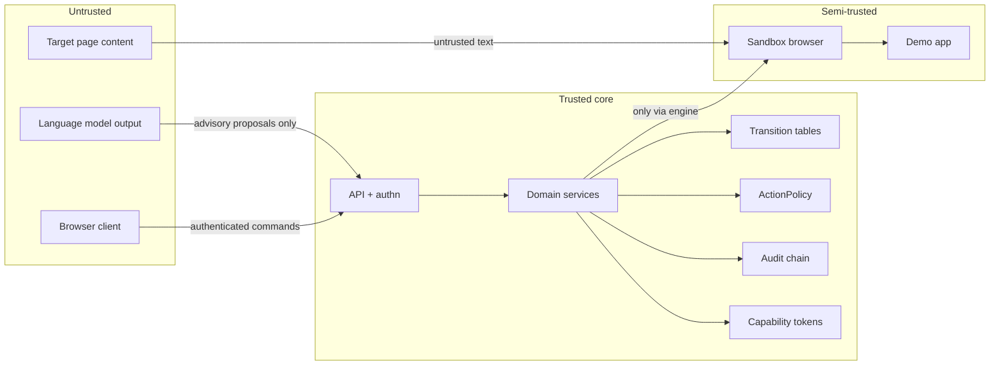

# FLOWSTATE AI — Security and Correctness Model

| Field | Value |
| --- | --- |
| Status | Draft for hackathon build |
| Related | [ARCHITECTURE.md](ARCHITECTURE.md), [STATE_MACHINES.md](STATE_MACHINES.md) |

FLOWSTATE executes actions on a user's behalf, so its security model is about
**authority**, not just access control. The central question for every step is: *who is
allowed to make this happen, and how do we know it did?*

## 1. Trust boundaries



| Boundary | Rule |
| --- | --- |
| LLM → core | Output is data, never a command. It is validated like any other untrusted input and cannot carry authority. |
| UI → core | Deployed modes authenticate every non-health command and authorize it server-side. Local development may be open. The UI never supplies a verdict, a status, or a capability token. |
| Target page → core | Page text is untrusted content. It is escaped on display and never interpreted as instructions to an agent. |
| Core → sandbox | Only the execution engine may drive the sandbox. The sandbox cannot call back into services to change state. |

## 2. The language model has no authority

Concretely, this means:

- An LLM may propose `ActionDefinition`s, selector fallbacks, or a recommended decision
  option. Each proposal is a **candidate** subject to the same validation as a
  deterministic one.
- There is no API endpoint that accepts "the model said it succeeded". Run status is
  derived only from transition tables and verification events.
- Approval endpoints require a human actor. Local development supports explicit test
  actor headers. In deployed modes the actor kind and role are server-configured; the
  default kind is `AGENT`, which cannot approve decisions. Set it to `HUMAN` only behind
  a trusted human-authentication gateway.
- Capability tokens are minted only by `DecisionService.authorize()` after a human
  approval transition. They are HMAC-signed with a server key, never derived from a model
  response.
- Prompt injection in captured page content cannot escalate: the engine executes only
  `ActionDefinition`s that were validated at publish time, and any *new* action requires a
  new published version.

## 3. ActionPolicy

A single policy object is consulted before every action. It is code, not configuration
that the model can edit at runtime.

```python
class ActionPolicy:
    def may_execute(self, action: ActionDefinition, ctx: RunContext) -> PolicyDecision: ...
    def required_authorization(self, action: ActionDefinition) -> AuthorizationRequirement: ...
    def resolve_origin(self, url: str) -> OriginDecision: ...
```

Rules enforced:

| Rule | Behaviour |
| --- | --- |
| Origin allow-list | The controlled demo is reachable on loopback only (`127.0.0.1`/`localhost` on the configured port, default `8000`, path `/demo-app/`). Every non-loopback origin is denied by `ActionPolicy` and the browser driver refuses to navigate before the request is made. |
| Payment routing | Any `PAYMENT_SIMULATED` action must target the demo origin. Real payment hosts are on a hard deny-list that no config can override. |
| Irreversible actions | Require `requires_authorization = true` unless explicitly allow-listed in code. |
| Destructive verbs | `delete`, `transfer`, `refund`-shaped actions are classified `IRREVERSIBLE` by kind and must declare a postcondition. |
| Rate / budget | Per-run action budget and deadline; exceeding either ends in `TIMED_OUT`. |
| Missing context | If policy cannot decide, the result is `ESCALATE` (human), never `ALLOW`. |

### Capture and learning boundary

- The recorder runs inside the controlled demo page only when an explicit `capture=1`
  flag is present. It posts structured events to the embedding console; it never receives
  or forwards cookies, headers or credentials.
- Sensitive input values (password/token/secret/authorization/card/CVV/IBAN/account/SSN)
  are replaced before the event leaves the page, and the backend redacts them again
  before persistence.
- Capture URLs drop query strings, so a session URL cannot smuggle a token into a run
  payload.
- Recorded locators are data, not code. The browser driver supports a fixed strategy
  allow-list (`role`, `label`, `testid`, `placeholder`, `text`, `css`) and never evaluates
  generated JavaScript.
- A selector that resolves to more than one element is rejected; ambiguous actions and
  sensitive redactions block saving until a human resolves them.
- Financial-shaped labels become `HUMAN_DECISION` nodes. The engine pauses and never
  auto-approves.
- Evidence files are content-addressed and hash-verified before `GET
  /runs/{id}/evidence/{evidenceId}` serves them.

### Alan adapter boundary

- The MCP server and CLI call the same typed `AlanOperations` boundary; neither executes
  generated code.
- Backend tokens are read from environment variables and never accepted as tool
  arguments. The HTTP MCP ingress has its own bearer token.
- Consequential tools require a deterministic confirmation token derived from the exact
  action and arguments; the Skill requires explicit user approval before the token is
  used.
- The adapter exposes no decision approval, workflow editing, deletion, arbitrary HTTP or
  shell tool. Workflow allowlisting and a read-only mode are available.
- Duplicate retries are controlled with `Idempotency-Key`; a reused key with different
  content is rejected.
- The adapter reports success only from a persisted `SUCCEEDED`/`VERIFIED` run.

Default-deny: an unknown action kind, an unknown origin, or an unparseable selector yields
`DENY`/`ESCALATE`.

## 4. Capability tokens

Issued only on `HumanDecision → AUTHORIZED`.

| Property | Value |
| --- | --- |
| Format | Opaque id + HMAC-SHA256 signature over `(decision_id, run_id, action_ordinal, expires_at, nonce)` |
| Scope | Exactly one `(run_id, action_ordinal)` |
| Lifetime | TTL (default 10 minutes), never extended |
| Use | Single-use; server records consumption, replay is rejected and audited |
| Storage | Server-side record; the token value is not stored in logs |
| Binding | Must match the decision that created it; a decision cannot mint a second token |

An approval that arrives after the decision expires is rejected even if the human clicked
in time, because the guard evaluates the injected clock at transition time.

## 5. Sandbox

The sandbox is **process-level**, not a container: Docker is not available in this
environment. Its guarantees come from configuration, not kernel isolation.

| Control | Implementation |
| --- | --- |
| Dedicated browser context | Fresh Playwright `BrowserContext` per run; no shared cookies or storage |
| Egress allow-list | `context.route("**/*")` aborts any request not to the demo origin; a catch-all handler makes the default deny, not allow |
| Host resolution | Browser launched with a resolver rule that maps external hosts to a dead local address |
| No credentials | The sandbox receives no real secrets; the demo app uses generated, per-run data |
| Filesystem | Downloads disabled; uploads restricted to a per-run temp directory |
| Resource caps | Per-action timeout, per-run deadline, max actions, max screenshot size |
| Teardown | Context closed and temp dir removed on success, failure and cancellation |
| Network assertions | Tests assert that zero non-demo requests were attempted |

**Documented limitation:** process-level isolation cannot contain a malicious browser
exploit. This is acceptable because the only target is a bundled demo application and the
hackathon scope excludes arbitrary third-party automation.

## 6. Never real financial transactions

This is enforced in four independent layers, so a single bug cannot cause a real charge:

1. **Kind-level:** `PAYMENT_SIMULATED` is the only payment-shaped action kind.
2. **Origin-level:** the sandbox route layer blocks every origin except the demo app.
3. **Policy-level:** a hard deny-list of payment and banking hostnames cannot be
   overridden by configuration.
4. **Data-level:** no real card numbers, bank accounts or credentials exist in the repo,
   fixtures or environment; the demo app accepts only obviously fake test values.

## 7. Ambiguous outcomes

An external action whose effect cannot be observed is `UNKNOWN`. The engine then runs a
**read-only confirming probe** — it never retries a possibly-committed action.

| Situation | Classification | Probe |
| --- | --- | --- |
| Timeout after request sent | `UNKNOWN` | Read target state; check for the action's effect marker |
| Connection dropped mid-response | `UNKNOWN` | Read target state |
| HTTP 5xx after send | `UNKNOWN` | Read target state |
| Duplicate response observed | `UNKNOWN` | Check idempotency key / effect count |
| Probe says effect present | `CONFIRMED` | — |
| Probe says effect absent | `FAILED` | Retry only if `RetryPolicy` allows and action is idempotent |
| Probe unavailable | `FAILED` | Escalate; never success |

Every action carries an idempotency key derived from `(run_id, ordinal, attempt)` so a
retry is distinguishable from a new intent.

## 8. Audit chain

- One `ExecutionEvent` per accepted transition, appended inside the same unit of work.
- `hash = sha256(prev_hash + canonical_json(payload) + type + seq)`; genesis uses `""`.
- `EventStore` exposes no update or delete.
- `GET /runs/{id}/events/verify` recomputes the chain and reports the first broken link.
- Events record actor (`SYSTEM`, `AGENT`, `HUMAN`, `POLICY`) and a reason string.
- Payloads are canonicalised (sorted keys, no floats where integers suffice) so the hash
  is reproducible across machines.

The chain is tamper-evident, not tamper-proof: someone with database write access could
rewrite the whole chain. For the MVP that is acceptable; a later version can anchor the
head hash externally (for example in an Alan artifact or a signed release note).

## 9. Secrets and data handling

| Concern | Rule |
| --- | --- |
| Configuration | Environment variables only, loaded via `pydantic-settings`; `.env` is gitignored; `.env.example` documents keys with placeholder values |
| Logging | Structured JSON logs pass a redaction filter for keys matching `token`, `secret`, `password`, `authorization`, `card`, `cvv` |
| Evidence | Screenshots and DOM snapshots are stored locally and hashed; no credentials are rendered by the demo app |
| Fixtures | Test fixtures use generated data only |
| Error responses | Problem+JSON returns a code and safe message; stack traces are logged server-side, never returned |
| Alan credentials | Never read, logged or persisted by the application |

## 10. Authentication and authorization (prototype boundary)

- `development`, `dev`, `test`, and `local` modes may run without a bearer token for
  loopback development. This is intentionally not an exposure-safe configuration.
- Every other environment fails settings validation unless `FLOWSTATE_API_TOKEN` and
  `FLOWSTATE_SECRET_KEY` are explicitly set to at least 32 characters and
  `FLOWSTATE_CORS_ORIGINS` contains no wildcard or loopback origins.
- Outside local development, actor ID, kind and role headers are ignored. The bearer
  credential maps to one server-configured principal with kind in
  `FLOWSTATE_API_ACTOR_KIND` and role in `FLOWSTATE_API_ACTOR_ROLE`. The default actor
  kind is `AGENT`, which fails closed for human decision actions.
- The configured principal is a shared service identity, not per-user authentication.
  Do not expose it directly to multiple users or claim tenant isolation. A trusted identity
  provider/reverse-proxy integration and per-user authorization are still required before
  multi-user or production use.
- Health probes remain unauthenticated. The demo app and real browser capture are designed
  for the local demo; do not enable their deployment routes in an internet-facing service.
- The SSE endpoint is mounted with the same bearer authentication dependency as the run
  API and exposes only the requested run's event chain. The current single-principal
  deployment model does not provide tenant-level ownership checks.

## 11. Security acceptance tests

| Test | Asserts |
| --- | --- |
| `test_policy_denies_non_allowlisted_origin` | Policy returns `DENY` for any non-demo URL |
| `test_sandbox_blocks_external_request` | A request to an external host is aborted and recorded |
| `test_payment_action_routes_to_demo_only` | A `PAYMENT_SIMULATED` action cannot target a real host |
| `test_agent_cannot_approve_decision` | Approval with an agent actor is rejected |
| `test_token_is_single_use` | Second consumption is rejected and audited |
| `test_token_expiry_uses_injected_clock` | Expired token rejected without sleeping |
| `test_unknown_outcome_never_succeeds` | Timeout path ends `UNKNOWN`, then `CONFIRMED`/`FAILED`, never `SUCCEEDED` directly |
| `test_audit_chain_detects_tampering` | Mutating an event breaks verification at the right seq |
| `test_logs_redact_secrets` | A planted secret never appears in log output |
| `test_no_real_payment_hosts_in_repo` | Static scan finds no real payment endpoints in code or fixtures |
