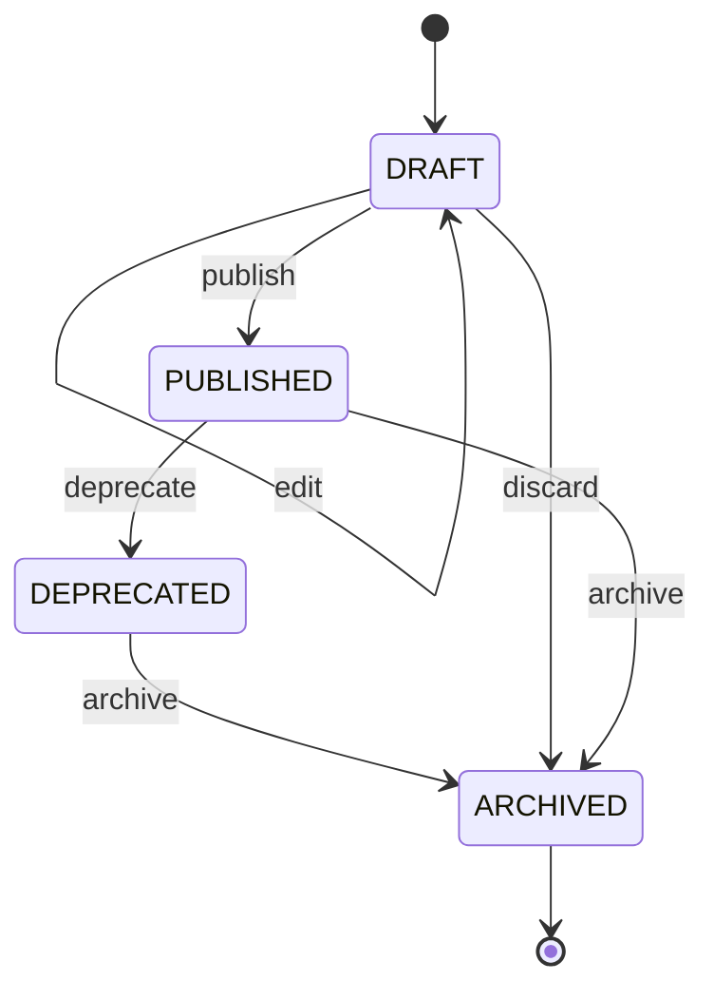
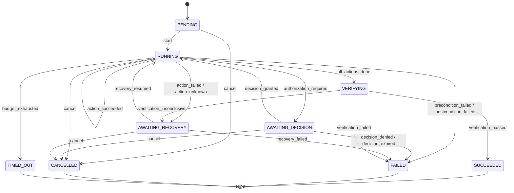
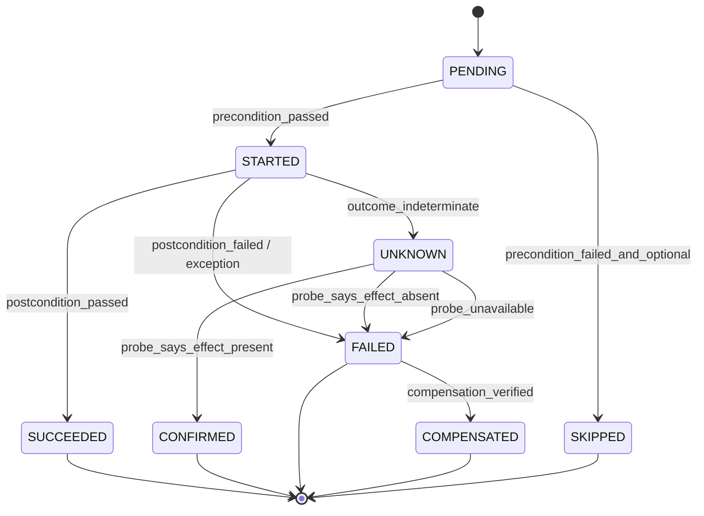
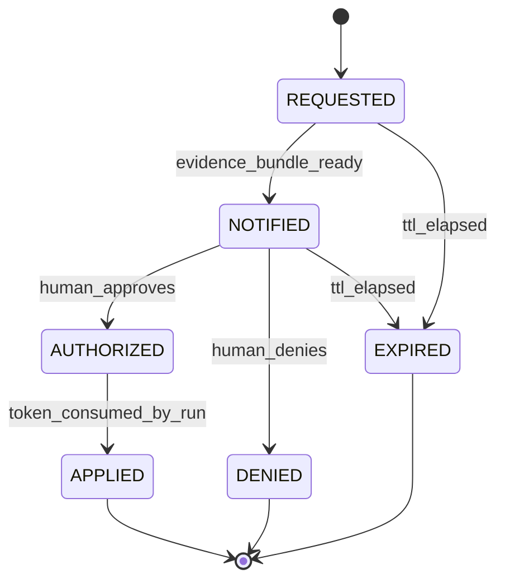
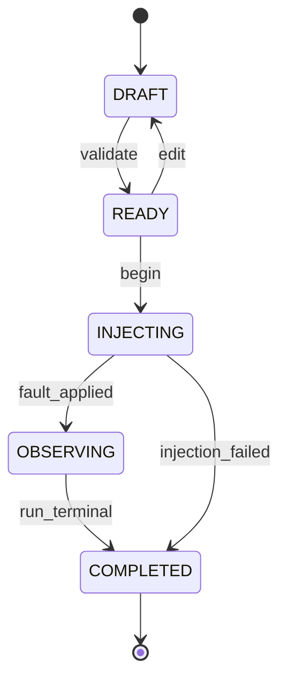
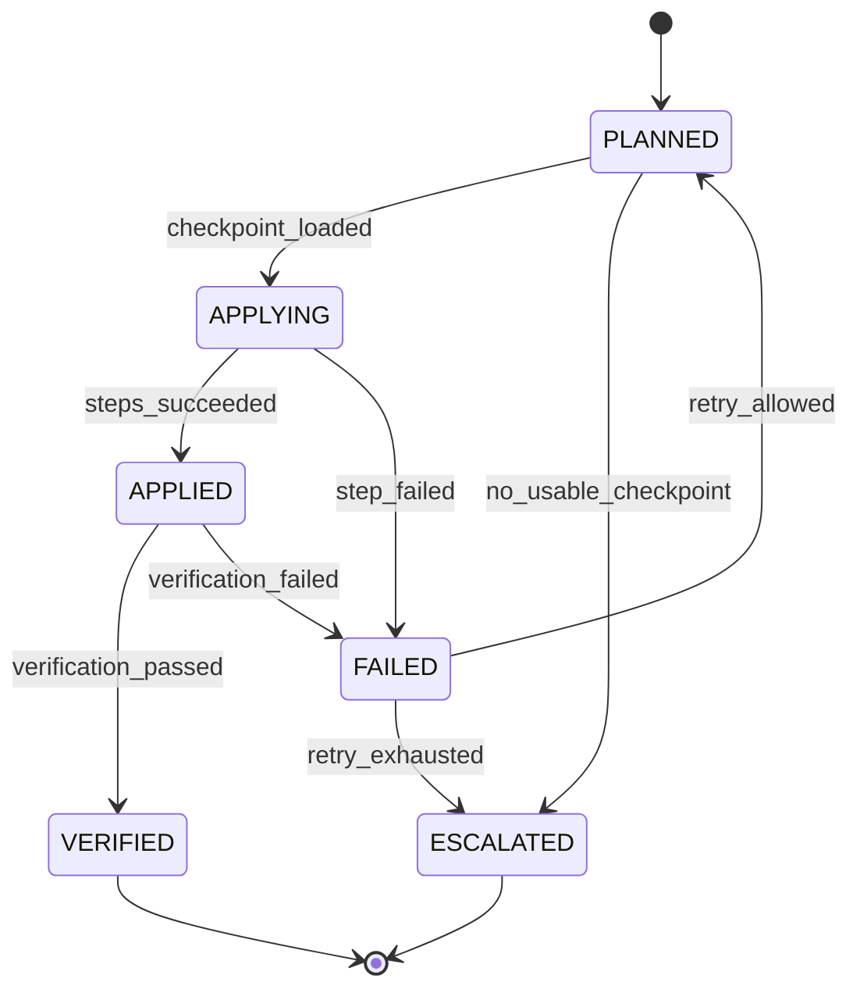
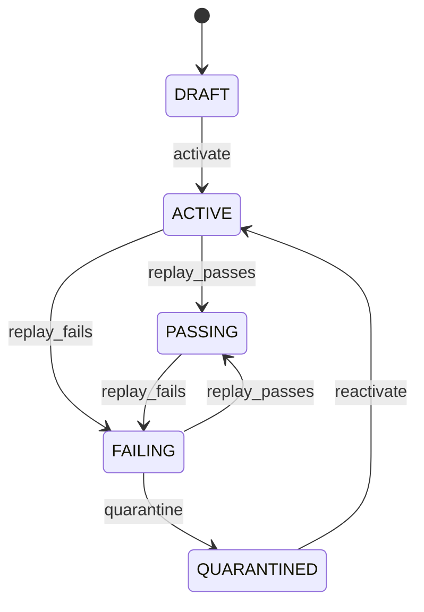
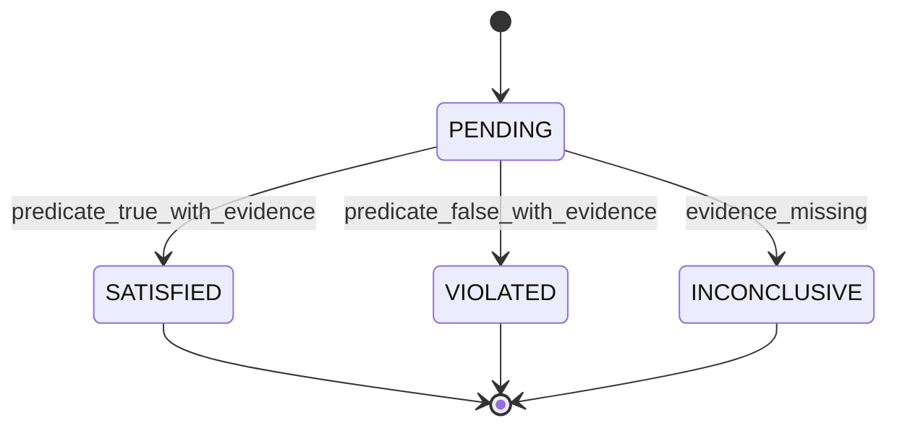

# FLOWSTATE AI — State Machines

| Field | Value |
| --- | --- |
| Status | Draft for hackathon build |
| Related | [DOMAIN_MODEL.md](DOMAIN_MODEL.md), [SECURITY.md](SECURITY.md) |

Every state change in FLOWSTATE goes through a **single transition table** in
`backend/flowstate/domain/statemachine.py`. Services never assign a status field
directly. A transition is a function:

```python
transition(machine, current_state, event, context) -> TransitionResult
```

`TransitionResult` is either `Accepted(next_state, emitted_events)` or
`Rejected(code, reason)`. `Accepted` results are what the audit writer persists: one
`ExecutionEvent` per accepted transition, appended in the same unit of work.

Guards are pure predicates over the domain objects and the injected clock. No guard
performs I/O.

---

## 1. Workflow version lifecycle



| From | Event | To | Guard |
| --- | --- | --- | --- |
| `DRAFT` | `edit` | `DRAFT` | version is not published; content hash recomputed |
| `DRAFT` | `publish` | `PUBLISHED` | every action validates against the live demo page; all `IRREVERSIBLE` actions are authorized or policy-allowed; invariants parse |
| `PUBLISHED` | `deprecate` | `DEPRECATED` | no run is currently `RUNNING` on this version |
| any | `archive` | `ARCHIVED` | no open runs |
| `PUBLISHED`/`DEPRECATED` | `edit` | — | **rejected**; editing forks a new `DRAFT` |

Content immutability after publish is enforced at the repository layer, not only here.

---

## 2. Execution run



| From | Event | To | Guard / side effect |
| --- | --- | --- | --- |
| `PENDING` | `start` | `RUNNING` | version is `PUBLISHED`; emits `RUN_CREATED`, `RUN_STARTED`; checkpoint `PRE_ACTION(0)` saved |
| `RUNNING` | `action_succeeded` | `RUNNING` | postconditions verified; advances `current_ordinal`; saves `POST_ACTION` checkpoint |
| `RUNNING` | `authorization_required` | `AWAITING_DECISION` | action is `requires_authorization`; creates `HumanDecision`; emits `DECISION_REQUESTED` |
| `RUNNING` | `action_failed` | `AWAITING_RECOVERY` | failure is recoverable (a usable checkpoint exists) |
| `RUNNING` | `action_unknown` | `AWAITING_RECOVERY` | confirming probe failed or is unavailable; **never** treated as success |
| `RUNNING` | `all_actions_done` | `VERIFYING` | all actions in a terminal success state |
| `RUNNING` | `precondition_failed` | `FAILED` | emits `PRECONDITION_FAILED` + `RUN_FAILED` |
| `RUNNING` | `postcondition_failed` | `FAILED` | emits `POSTCONDITION_FAILED` + `RUN_FAILED` |
| `AWAITING_DECISION` | `decision_granted` | `RUNNING` | capability token valid, unconsumed, unexpired; token consumed |
| `AWAITING_DECISION` | `decision_denied` | `FAILED` | decision terminal; no action executed |
| `AWAITING_DECISION` | `decision_expired` | `FAILED` | clock past `expires_at` |
| `AWAITING_RECOVERY` | `recovery_resumed` | `RUNNING` | `RecoveryAttempt.status == APPLIED` and a checkpoint restored |
| `AWAITING_RECOVERY` | `recovery_failed` | `FAILED` | recovery `FAILED` or `ESCALATED` |
| `VERIFYING` | `verification_passed` | `SUCCEEDED` | all postconditions + invariants `SATISFIED`; zero unresolved `UNKNOWN`; emits `RUN_VERIFIED` |
| `VERIFYING` | `verification_failed` | `FAILED` | any invariant `VIOLATED` |
| `VERIFYING` | `verification_inconclusive` | `AWAITING_RECOVERY` | evidence missing or outcome `UNKNOWN` |
| `RUNNING`/`AWAITING_*` | `cancel` | `CANCELLED` | actor authorized to cancel |
| `RUNNING` | `budget_exhausted` | `TIMED_OUT` | run deadline passed |

**Terminal states:** `SUCCEEDED`, `FAILED`, `CANCELLED`, `TIMED_OUT`. No transition leaves
a terminal state.

### Why `AWAITING_RECOVERY` rather than `FAILED`

A recoverable failure and an unrecoverable one are different products of the same event.
`FAILED` is terminal and means "a human must look at this". `AWAITING_RECOVERY` means
"the engine still holds a valid restore point and will try". Collapsing them would make
the recovery feature unreachable and would let the UI report a recoverable run as dead.

---

## 3. Action lifecycle (within a run)



| From | Event | To | Notes |
| --- | --- | --- | --- |
| `PENDING` | `precondition_passed` | `STARTED` | emits `ACTION_STARTED` |
| `PENDING` | `precondition_failed_and_optional` | `SKIPPED` | only for actions marked optional |
| `STARTED` | `postcondition_passed` | `SUCCEEDED` | emits `ACTION_SUCCEEDED` |
| `STARTED` | `postcondition_failed` / `exception` | `FAILED` | emits `ACTION_FAILED` |
| `STARTED` | `outcome_indeterminate` | `UNKNOWN` | timeout, dropped connection, 5xx after send, duplicate response. **The only correct state for an ambiguous external effect.** |
| `UNKNOWN` | `probe_says_effect_present` | `CONFIRMED` | probe must be a read-only observation, not a retry |
| `UNKNOWN` | `probe_says_effect_absent` | `FAILED` | safe to retry if `RetryPolicy` allows |
| `UNKNOWN` | `probe_unavailable` | `FAILED` | stays a failure; never silently succeeds |
| `FAILED` | `compensation_verified` | `COMPENSATED` | compensating action succeeded and verified |

`UNKNOWN` is a first-class state, not an error code. It is what makes the "never claim
success without verification" rule mechanical rather than aspirational.

---

## 4. Human decision / approval



| From | Event | To | Guard |
| --- | --- | --- | --- |
| `REQUESTED` | `evidence_bundle_ready` | `NOTIFIED` | every `evidence_ids` entry exists and hashes correctly |
| `NOTIFIED` | `human_approves` | `AUTHORIZED` | deciding actor is an authenticated human; decision is still open; clock < `expires_at` |
| `NOTIFIED` | `human_denies` | `DENIED` | same actor check |
| `NOTIFIED`/`REQUESTED` | `ttl_elapsed` | `EXPIRED` | clock ≥ `expires_at` |
| `AUTHORIZED` | `token_consumed_by_run` | `APPLIED` | token matches `(run_id, action_ordinal, decision_id)`; token unused |

**Capability token properties** (see [SECURITY.md](SECURITY.md)): HMAC-signed by the
backend, single-use, TTL-bounded, bound to one run and one action, and stored server-side
so replay is detectable. An LLM can *propose* an option but cannot call the approve
endpoint on a human's behalf.

---

## 5. Fault testing (scenario)



| From | Event | To | Guard |
| --- | --- | --- | --- |
| `DRAFT` | `validate` | `READY` | target action exists in the pinned version; parameters valid for `fault_type`; seed present |
| `READY` | `begin` | `INJECTING` | a chaos run is created against the pinned version |
| `INJECTING` | `fault_applied` | `OBSERVING` | the injector confirms the fault is active at the boundary |
| `OBSERVING` | `run_terminal` | `COMPLETED` | every attached invariant has a verdict; results recorded |
| `INJECTING` | `injection_failed` | `COMPLETED` | recorded as `INCONCLUSIVE`, never as a pass |

Scenario verdict aggregation: `VIOLATED` if any `CRITICAL`/`MAJOR` invariant is violated;
`SATISFIED` only if all invariants are satisfied; otherwise `INCONCLUSIVE`.

---

## 6. Recovery attempt



| From | Event | To | Guard |
| --- | --- | --- | --- |
| `PLANNED` | `checkpoint_loaded` | `APPLYING` | checkpoint belongs to the run; `state_hash` matches |
| `PLANNED` | `no_usable_checkpoint` | `ESCALATED` | strategy cannot proceed without human input |
| `APPLYING` | `steps_succeeded` | `APPLIED` | every step outcome is success |
| `APPLYING` | `step_failed` | `FAILED` | records which step |
| `APPLIED` | `verification_passed` | `VERIFIED` | verification event exists with all invariants `SATISFIED` |
| `APPLIED` | `verification_failed` | `FAILED` | |
| `FAILED` | `retry_allowed` | `PLANNED` | attempts < policy max |
| `FAILED` | `retry_exhausted` | `ESCALATED` | |

`APPLIED` deliberately does **not** mean recovered. Only `VERIFIED` does.

---

## 7. Regression test



| From | Event | To | Guard |
| --- | --- | --- | --- |
| `DRAFT` | `activate` | `ACTIVE` | spec pins workflow version + seed; replays twice with identical results |
| `ACTIVE`/`PASSING` | `replay_fails` | `FAILING` | invariant violated on replay |
| `FAILING` | `replay_passes` | `PASSING` | |
| `FAILING` | `quarantine` | `QUARANTINED` | a human records why (flaky vs genuine) |
| `QUARANTINED` | `reactivate` | `ACTIVE` | |

---

## 8. Invariant verdict machine



`INCONCLUSIVE` exists so that "we could not tell" cannot be laundered into "it passed".

---

## 9. Implementation notes

- One module, `flowstate/domain/statemachine.py`, holds all tables above as immutable
  `dict[State, dict[Event, Transition]]` structures.
- Each `Transition` carries `(next_state, guards: tuple[Callable, ...], emits:
  tuple[EventType, ...])`.
- The audit writer takes `Accepted` results and appends events inside the same
  `UnitOfWork`, so a status change without an event is impossible by construction.
- Property-based tests (Hypothesis) assert: no transition leaves a terminal state; every
  reachable state has an event in the audit log; guards never mutate input.
