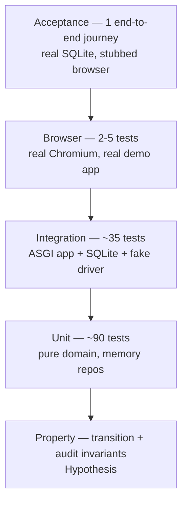
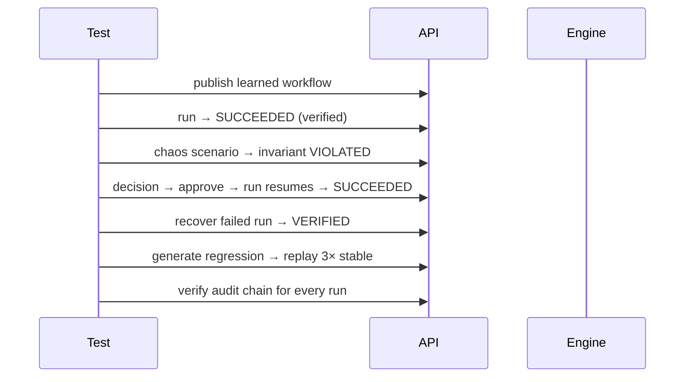

# FLOWSTATE AI — Test Strategy

| Field | Value |
| --- | --- |
| Status | Ready to execute |
| Related | [ACCEPTANCE_CRITERIA.md](ACCEPTANCE_CRITERIA.md), [IMPLEMENTATION_PLAN.md](IMPLEMENTATION_PLAN.md) |

The product's value proposition is *trustworthy verification*. A flaky test suite would
contradict the product, so determinism is a first-class requirement, not a nicety.

## 1. Test pyramid



| Layer | Count target | Runtime | Gate |
| --- | --- | --- | --- |
| Unit | ~90 | < 10 s | `make verify` |
| Property | ~10 | < 20 s | `make verify` |
| Integration | ~55 | < 60 s | `make verify` |
| Browser | 4 | < 30 s | `make verify-all` |
| Acceptance (console journeys) | 3 | < 60 s | `make verify-all` |
| Frontend | 20 | < 30 s | `make verify` |

Coverage targets: **≥ 90%** line coverage on `domain/`, `services/`, `repositories/`;
**≥ 80%** overall on `backend/flowstate`. `capture/` and `sandbox/` are covered by browser
tests and excluded from the line-coverage gate.

## 2. The determinism kit

Every non-deterministic dependency is a protocol with a test implementation.

| Dependency | Protocol | Test implementation |
| --- | --- | --- |
| Time | `Clock.now() -> datetime` | `FrozenClock(start)` with `advance(seconds)` |
| Randomness | `RandomSource` | seeded from the run's `seed` |
| Sleeping | `Sleeper.sleep(seconds)` | `InstantSleeper` records calls, never blocks |
| IDs | `IdFactory.new()` | `SequentialIdFactory` for stable snapshots |
| Browser | `ActionDriver` port | `FakeDriver` with scripted outcomes |
| Network | sandbox routes | demo-origin stub; everything else aborted |

**Banned in tests:** `time.sleep`, `datetime.now()`, `random.random()` without a seed,
live HTTP, unseeded Playwright, snapshot tests of wall-clock timestamps.

A pre-commit check (`ruff` rule + a grep-based unit test) fails the build if `time.sleep`
appears under `backend/tests/`.

## 3. Fixtures

`backend/tests/conftest.py` provides:

- `clock` — `FrozenClock` at a fixed instant.
- `ids` — `SequentialIdFactory`.
- `uow` — memory `UnitOfWork` (fast unit tests).
- `sqlite_uow` — temp-file SQLite with migrations applied (integration).
- `app` — FastAPI app with overridden dependencies.
- `client` — `httpx.AsyncClient` over `ASGITransport`.
- `auth_headers` / `agent_headers` / `human_headers` — actor identities.
- `published_workflow` — a 3-action fixture version with one authorized action.
- `demo_server` — session-scoped demo app on an ephemeral port.
- `fake_driver` — scripted outcomes per ordinal.

Fixtures are function-scoped unless noted; no fixture mutates another fixture's state.

## 4. Test types

### 4.1 Transition table tests

One parametrised test per machine, driven by the table itself:

```python
@pytest.mark.parametrize("from_state,event,expected", RUN_TABLE_CASES)
def test_run_transitions(...): ...
```

Plus negative cases: every `(state, event)` pair not in the table must be rejected. This
is generated programmatically so a new state cannot be added without covering it.

### 4.2 Property tests (Hypothesis)

| Property | Assertion |
| --- | --- |
| Terminal absorption | No sequence of valid events leaves a terminal state |
| Audit completeness | Every accepted transition has exactly one event |
| Chain integrity | Any prefix of a run's events verifies |
| Seq contiguity | `seq` is `0..n-1` with no gaps |
| Ordinal monotonicity | Actions execute in non-decreasing ordinal order |
| Token single-use | Any second consumption is rejected |
| Invariant aggregation | `VIOLATED` dominates, `INCONCLUSIVE` never becomes `SATISFIED` |

### 4.3 Integration tests

Drive the real ASGI app with SQLite. The browser is replaced by `FakeDriver` so these
tests are fast and deterministic. They cover routing, auth, validation, persistence,
audit writes, and service orchestration.

### 4.4 Browser tests

Real Chromium against the real demo app. Only for things that cannot be faked:
capture fidelity, selector resolution and safe failure on structure drift. Marked
`@pytest.mark.browser`, skipped by default, excluded from `make verify` and run by
`make test-browser` / `make verify-all`.

The API-level learning and browser-chaos tests use
`tests/fakes.py::FakeBrowserSession`, which models the controlled demo only. It keeps
integration tests fast while still driving the real engine, input substitution,
postconditions, `UNKNOWN` reconciliation, selector-drift injection and evidence writes.

Chaos coverage is split by what must be proven:

- `unit/test_faults.py` — every sandbox fault's effect and classification, including
  request-phase versus response-phase faults.
- `unit/test_invariants.py` — compare/implies policy, authorization, postcondition and
  checkpoint checks.
- `integration/test_chaos_report.py` — baseline/fault reports, first violation, safe
  failure, recovery, regression, delayed approval, every invoice fault family and the
  browser selector-drift path.
- `browser/test_playwright_capture.py` — real Chromium selector drift through the Chaos API.

```bash
PYTHONPATH=backend .venv/bin/pytest backend/tests -m browser -q
```

### 4.5 Acceptance test

One journey that proves the product loop:



It runs against SQLite with the fake driver so it is deterministic, and a second
`@pytest.mark.browser` variant proves the same journey against real Chromium.

## 5. Markers

| Marker | Meaning | In default gate |
| --- | --- | --- |
| `unit` | Pure domain | yes |
| `integration` | ASGI + SQLite | yes |
| `browser` | Real Chromium | no |
| `slow` | > 1 s | no |
| `acceptance` | Full journey | no |

`pytest.ini` sets `addopts = -m "not browser and not slow"` for the default run and
`--strict-markers`.

## 6. What is asserted about security

Security is tested as behaviour, not reviewed as prose. See
[SECURITY.md](SECURITY.md#11-security-acceptance-tests) for the full list. The key
non-negotiables:

- Origin denial is tested at both the policy layer and the browser layer.
- Payment-shaped actions are proven to route to the demo origin.
- Agent identities cannot approve decisions.
- Tokens are single-use and TTL-bounded on the injected clock.
- A planted secret never appears in logs.
- A static scan asserts no real payment host exists in code or fixtures.

## 7. Frontend testing

- **Vitest + Testing Library** for components and hooks. No snapshot tests of markup;
  assert roles, labels and text.
- **Status encoding:** every badge test asserts icon + text, not only colour.
- **Responsive:** a test renders primary screens at 380 px and asserts no horizontal
  overflow.
- **API contract:** the generated client is typechecked against `/openapi.json`; a schema
  change that breaks the client fails `npm run typecheck`.

## 8. CI and the local gate

There is no hosted CI configured yet. The gate is `make verify`:

```make
verify: lint typecheck test-unit test-integration test-frontend
verify-all: verify test-browser test-acceptance
```

Order matters: cheap and deterministic first, so a failure is reported in seconds.

```bash
make verify        # ruff, mypy, unit, property, integration, frontend test + build
make verify-all    # adds browser + acceptance
```

## 9. Evidence and reporting

- Integration and browser tests write run artefacts to `artifacts/` (gitignored).
- Acceptance runs produce a test report via Alan `create_test_report`, with screenshots
  published through `publish_capture`.
- Every acceptance claim in the report links to a test id from
  [ACCEPTANCE_CRITERIA.md](ACCEPTANCE_CRITERIA.md).

## 10. Flake policy

1. A test that fails intermittently is quarantined within one working session.
2. Quarantine requires a reason: `genuine` (a real bug) or `nondeterministic` (a harness
   defect).
3. `nondeterministic` is fixed by removing the source of nondeterminism, not by adding a
   retry. Retries are only permitted at the browser-harness level, never for unit or
   integration tests.
4. No test may be deleted to make the suite green; it is either fixed or quarantined with
   a linked note.
